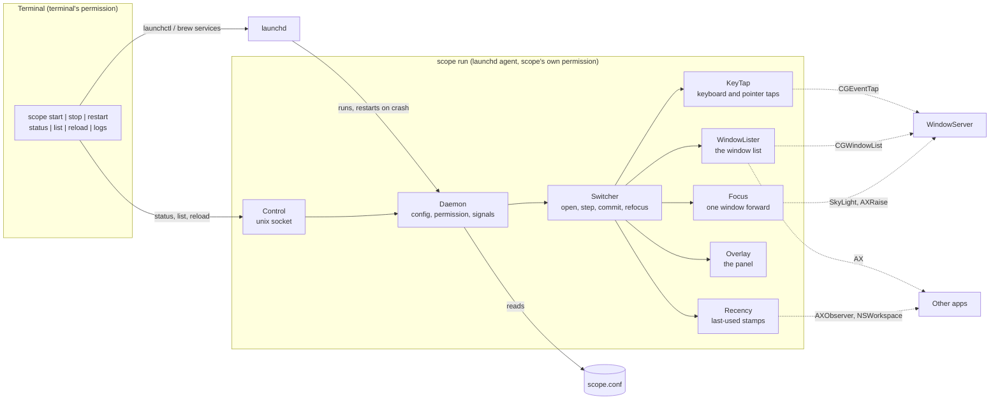
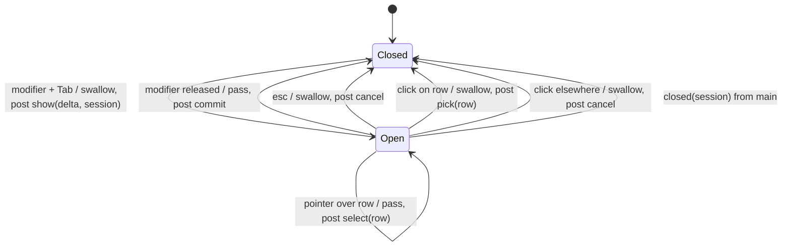

# Implementation

A specification for building scope from nothing. It states what scope must do, the macOS behaviour that dictates how, and the design that results, down to the constants. Every rule that looks arbitrary exists because of a platform fact in [Platform facts](#platform-facts); the rule cites it as **[Fn]**.

[README.md](README.md) covers using scope. The code in `Sources/Scope` is one implementation of this document.

## Required behaviour

**Switcher**

- <kbd>⌘</kbd> <kbd>Tab</kbd> opens a vertical list of the **windows** on the **current Space**, most recently used first, and selects the second row. <kbd>⌘</kbd> <kbd>⇧</kbd> <kbd>Tab</kbd> opens it with the last row selected.
- Further <kbd>Tab</kbd> / <kbd>⇧</kbd> <kbd>Tab</kbd> while <kbd>⌘</kbd> is held moves the selection, wrapping around.
- Releasing <kbd>⌘</kbd> focuses the selected window. <kbd>esc</kbd> closes the list without switching.
- So a quick press-and-release always toggles between the two most recent windows.
- With the pointer, while <kbd>⌘</kbd> is held: hovering a row selects it, clicking a row switches to it, clicking anywhere else closes without switching. Clicks never reach the windows underneath.
- Fewer than two windows on the Space: nothing opens.
- Focusing brings forward that one window, not every window of its app.
- A native tab group (Terminal, Finder…) is one row, showing the tab that is up.
- The modifier is configurable: `cmd` replaces the system switcher, `alt` and `ctrl` run beside it.
- Every key other than the ones the switcher uses passes through untouched, and ⌘Tab is never lost to the system switcher, however slow other apps are.

**Refocus after a Space switch**

- On arriving at a Space, if macOS left nothing there focused, or focused a window only because its app was active on the Space you left, focus the window you last used on this Space.
- A window you chose (Dock, notification, Mission Control, scope itself) is left alone.
- If scope has never seen a window on this Space used, leave focus alone.

**Service**

- One signed binary, `scope`, run by launchd as a per-user agent: starts at login, restarted after a crash, not after a clean stop.
- Controlled with `scope start | stop | restart | reload | status | logs | list | run | version`.
- Configured by `~/.config/scope/scope.conf`; never writes it.
- Needs only the Accessibility permission. Asks for it once, then starts by itself when it is granted.

## Platform facts

What macOS does, as observed while building scope (most recently on macOS 26). Each one broke an earlier design; re-check them when a macOS release changes behaviour.

### Keys and events

- **F1.** The Dock owns <kbd>⌘</kbd> <kbd>Tab</kbd>. It cannot be registered as a hotkey (the registration fails or never fires), it is not a symbolic hotkey, and System Settings has no switch to disable it. A session event tap (`.cgSessionEventTap`, `.headInsertEventTap`, `.defaultTap`) sees the key before the Dock and can swallow it.
- **F2.** An event tap callback has a deadline. Miss it and macOS disables the tap (`tapDisabledByTimeout`) and delivers the key onwards: the system switcher appears. Secure input (password fields) disables taps too (`tapDisabledByUserInput`). A disabled tap must be re-enabled by hand.
- **F3.** The modifier's release arrives as `flagsChanged`, not `keyUp`.
- **F4.** Swallowing `mouseMoved` freezes the cursor. A tap that sees `mouseMoved` runs its callback continuously.
- **F5.** Event locations are in global coordinates with a top-left origin. AppKit window frames have a bottom-left origin: `cgY = primaryScreenHeight − appKitMaxY`.

### Windows

- **F6.** `CGWindowListCopyWindowInfo([.optionOnScreenOnly, .excludeDesktopElements])` lists exactly the windows ordered in on the Spaces currently showing, frontmost first, with id, pid, layer and bounds. It is public, fast, and needs no permission for those fields. Window *titles* from it need Screen Recording permission, so titles must come from Accessibility.
- **F7.** Document windows are layer 0. The menu bar, Dock, menus and floating panels are higher layers.
- **F8.** Many apps keep invisible helper windows in every Space to render popups (Microsoft Teams keeps a 680×932 window titled "Window"). They, and sheets and dialogs, have an Accessibility subrole other than `AXStandardWindow`.
- **F9.** Native window tabs: every tab is a separate window with its own id, but only the front tab is on screen and visible to Accessibility. Switching or closing tabs swaps windows without reliable notifications. A tab switched to by keyboard may announce nothing at all. The tabs behind cannot be listed or targeted.
- **F10.** An Accessibility window element maps to its window-server id only through the private `_AXUIElementGetWindow`.
- **F11.** Native-fullscreen windows each live on their own Space.
- **F12.** Maximized windows of one app on two Spaces can have identical frames.

### Accessibility

- **F13.** Some apps answer Accessibility slowly — Electron apps, and an Android emulator and IDE during a debug build — and the default timeout is seconds. `AXUIElementSetMessagingTimeout` on the system-wide element sets it for every call the process makes.
- **F14.** `AXObserverAddNotification` fails for an app that has only just launched; it succeeds a few seconds later.
- **F15.** Notifications are delivered asynchronously. A focus change from a switch made a moment ago may not have been seen yet when the next ⌘Tab arrives.
- **F16.** `AXIsProcessTrusted` changes post no notification; it must be polled. `AXIsProcessTrustedWithOptions` with the prompt option adds the process to the Accessibility list, so there is a switch to turn on.

### Focus and Spaces

- **F17.** Activating an app brings all its windows forward. One window alone needs the private `_SLPSSetFrontProcessWithOptions` with `kCPSUserGenerated` (0x200), then two synthesized "make key window" event records via `SLPSPostEventRecordTo`, then `AXRaise`. Without the event records, key focus can stay on another window of the same app. `AXRaise` must come last, because SetFrontProcess orders the app but not the window among the app's own.
- **F18.** A panel that accepts mouse events can take focus. `.nonactivatingPanel` with `ignoresMouseEvents` cannot.
- **F19.** Switching Spaces does not reliably move keyboard focus. The app active on the Space you left stays active if it has no window on the new one (Finder after a click on the desktop is the usual case): your last window is in front, but typing goes nowhere. If that app *does* have a window on the new Space, macOS focuses it, which looks exactly like a choice.
- **F20.** `activeSpaceDidChangeNotification` is posted after the switch animation. The switch itself fires activation, deactivation and focus-change notifications, so it generates "use" of the windows it lands on.
- **F21.** Choosing a window from the Dock, a notification or Mission Control activates its app (`didActivateApplicationNotification`). macOS carrying the active app over to a window on the new Space does not.
- **F22.** The active Space comes from the private `SLSGetActiveSpace(SLSMainConnectionID())` (older name: `CGS…`). Private symbols disappear between macOS releases.

### Permission, signing, launchd

- **F23.** The Accessibility permission belongs to the *responsible* process. Started by launchd, that is the binary itself. Started from a shell, it is the terminal app, whatever binary runs.
- **F24.** An unbundled binary's permission is keyed to its **path** and its code signature's designated requirement. Same path, same certificate: the permission survives rebuilds. Another path, or an ad-hoc signature (which changes with every build): it must be granted again.
- **F25.** If the binary has a reverse-DNS signing identifier, or an `Info.plist` (embedded with `-sectcreate __TEXT __info_plist`, or simply next to the binary), tccd files the permission under a **bundle ID**, then fails to find an app with that ID (`kLSApplicationNotFoundErr`) and denies. The entry shows in System Settings with a folder icon, named after the identifier's last component; turning it on does nothing, and `tccutil reset` cannot remove it.
- **F26.** An untrusted self-signed code-signing certificate works for `codesign` and gives a stable designated requirement (`identifier "scope" and certificate leaf = H"…"`). `security find-identity -v` hides untrusted certificates; without `-v` it lists them.
- **F27.** Overwriting a signed binary in place while it runs gets the process killed. Replacing it by rename does not.
- **F28.** `launchctl bootstrap` straight after `bootout` of the same label fails transiently with an I/O error.
- **F29.** launchd agents do not inherit the shell's environment, and `$TMPDIR` can differ between them. `confstr(_CS_DARWIN_USER_TEMP_DIR)` is the same for both.
- **F30.** `log stream` shows `notice` and above by default; `info` and `debug` messages are hidden.

## Architecture



| Component | File | Responsibility |
|---|---|---|
| CLI | `main.swift`, `Service.swift` | Commands; launchd and `brew services` control |
| Daemon | `Daemon.swift` | The service process: config, permission, signals, socket answers |
| Control | `Control.swift` | Unix socket, client and server |
| Config | `Config.swift` | `scope.conf` parser |
| Switcher | `Switcher.swift` | The switcher's state; refocus after a Space switch |
| KeyTap | `KeyTap.swift` | Event taps and the open/closed decision |
| WindowLister | `Windows.swift` | The current Space's windows |
| Recency | `Recency.swift` | Last-used stamps and ranking |
| Overlay | `Overlay.swift` | Drawing the list |
| Focus | `Focus.swift` | Bringing one window forward |
| SkyLight | `Private.swift` | Every private symbol |
| Support | `Support.swift` | Logging, version, a thread with its own run loop |

### Threads

The rule: nothing that can wait on another app runs where it can delay a key **[F2, F13]**.

| Thread | Runs | Must never |
|---|---|---|
| `scope.tap` (own run loop) | Tap callbacks: decide swallow or pass, post an action to main | wait for anything, call Accessibility, take a lock held across slow work |
| main | Switcher, Overlay, building the list, refocus, config reloads | — |
| `scope.recency` (own run loop) | AX observers and NSWorkspace stamps | — |
| `scope.focus` (serial queue) | `Focus.window` | — |
| `scope.control` | Socket accept loop; runs commands on main synchronously | — |
| concurrent pool | One AX query per app while building the list | — |

## KeyTap

Two taps on the `scope.tap` thread, created at start **[F1]**:

- **keys**: `keyDown` and `flagsChanged`, always enabled.
- **pointer**: `mouseMoved`, `leftMouseDragged`, `leftMouseDown`, `leftMouseUp`. Created disabled; enabled only while the overlay is on screen **[F4]**.

The tap, not the overlay, owns whether the switcher is open. It flips `open` the moment it swallows the activation, before any list exists, so keys that arrive while the list is still being built step or commit instead of opening a second switcher. Every opening gets a new `session` number. Calls back from main (`shown`, `closed`) carry the session and are ignored if it is stale, so a commit still being carried out cannot close the switcher the next ⌘Tab just opened.



Callback rules:

- `tapDisabledByTimeout` / `tapDisabledByUserInput`: re-enable the keys tap, and the pointer tap if the overlay is up **[F2]**.
- `flagsChanged` without the modifier while open: commit. The event itself passes **[F3]**.
- `keyDown` while open: Tab (keycode 48) steps (Shift reverses), Escape (53) cancels; both swallowed. Any other key passes.
- `keyDown` while closed: Tab with the modifier opens; anything else passes.
- `mouseMoved` / `leftMouseDragged`: never swallowed **[F4]**; select the row under the pointer.
- `leftMouseDown` while open with geometry known: swallowed, so it never reaches the window underneath. The decision waits for the release.
- `leftMouseUp` while open: swallowed; the row under the pointer is picked, or the switcher is cancelled.
- State (`open`, `session`, `modifier`, `mouse`, `geometry`) is guarded by one lock, held only for the decision.

Row hit-testing is arithmetic, in global top-left coordinates **[F5]**: `row = floor((y − frame.minY − padding) / rowHeight)`, if the point is inside the frame and the row exists.

## WindowLister

Built fresh on every open; there is no window cache **[F9]**.

1. `CGWindowListCopyWindowInfo([.optionOnScreenOnly, .excludeDesktopElements])` **[F6]**. Keep layer 0 only **[F7]**, drop scope's own pid. Record id, pid, bounds, and z (position in this list, 0 frontmost).
2. Group the ids by pid. For each pid, **in parallel** (`concurrentPerform`): read `kAXWindowsAttribute` of `AXUIElementCreateApplication(pid)`, map each element to an id with `_AXUIElementGetWindow` **[F10]**, keep the ids from step 1, and read subrole and title in one `AXUIElementCopyMultipleAttributeValues`.
3. Keep only `AXStandardWindow` **[F8]**.
4. An app that does not answer within the messaging timeout (250ms, set once on the system-wide element **[F13]**) is represented by its last known answer. Keep those answers in a table keyed by window id; when it passes 512 entries, drop the ids not on screen.
5. Result: windows in stacking order with id, pid, AX element, title, frame (top-left global) and z.

Fullscreen apps drop out by themselves **[F11]**. A tab group yields one window, the tab that is up **[F9]**.

## Recency

A table `window id → Stamp { at, previous, pid, frame, space }`, `at` in `systemUptime` seconds, guarded by a lock, written on the `scope.recency` thread.

**Stamp sources.** Each stamps the app's *focused* window (`kAXFocusedWindowAttribute`), with its frame and the active Space **[F22]**:

- an `AXObserver` per regular app for `kAXFocusedWindowChangedNotification`, its run-loop source on the recency thread. Observe every running regular app at start and each app on launch. If adding the notification fails, retry every second, five times **[F14]**. Remove on terminate, along with that pid's stamps.
- `didActivateApplicationNotification`;
- `didDeactivateApplicationNotification`. A tab switched to by keyboard may announce nothing, but the app still names it as focused on the way out, and every Space switch deactivates something **[F9, F20]**.
- the frontmost app once at start.

**Bursts.** One switch stamps the same window several times within milliseconds (activated, focus changed, deactivated). Each stamp keeps `previous` = the newest use at least `history` (1s) older than itself:

```
old = stamps[id]
previous = old == nil ? nil : (now − old.at ≥ 1s ? old.at : old.previous)
stamps[id] = Stamp(at: now, previous, pid, frame, space)
if stamps.count > 1024: keep the 512 newest
```

`stamp.before(cutoff)` is the stamp as it stood at `cutoff`: itself if `at < cutoff`, else `previous` if that is `< cutoff`, else nothing.

**Ranking** `rank(windows, before: cutoff = ∞)`:

```
for each window w:
    used(w) = stamps[w.id].before(cutoff).at
    for each other stamp s with s.id not on screen, s.pid == w.pid,
        s.space == active Space, frames equal within 2pt:     # hidden tabs of w's tab group [F9, F12]
        used(w) = max(used(w), s.at)
sort: by used descending; any used before none; ties and never-used by z ascending
```

A tab group therefore ranks by the newest use of any of its tabs.

## Switcher

All on main.

**`currentWindows()`** = `recency.rank(lister.currentSpace())`, then the focused window (a live query: frontmost app's `kAXFocusedWindowAttribute`) moved to the front **[F15]**. The stamps may not yet know about a switch made a moment ago; without this, the window you are on can rank second, and the quick toggle lands on the window you are already in.

**show(delta, session):** if already visible, step instead. Build the list; if fewer than 2 windows, tell the tap `closed(session)` and stop. Select row 1 (forward) or the last row (backward). Rows: title (or `(untitled)`), the app's `localizedName`, the app's icon (cached per pid, dropped on terminate). Show the overlay on the screen containing the centre of the first window, then `tap.shown(geometry, session)`. Arm the watchdog.

**step(delta):** `index = (index + delta) mod count`. **select(row):** update the highlight, rearm the watchdog. **commit:** hide, then `Focus.window(selected)`. **cancel:** hide. Hiding always calls `tap.closed(session)`.

**Watchdog:** 10s without interaction tears the overlay down, in case a modifier release is ever missed. Rearmed on every selection, so choosing slowly with the mouse is not cut off.

### Refocus after a Space switch

State: `spaceChangedAt`, `lastActivation`, `refocused = (pid, at)`.

- On `didActivateApplicationNotification`: ignore it if it is the app scope itself just refocused within 0.5s; otherwise `lastActivation = now`.
- On `activeSpaceDidChangeNotification` (if `refocus` is on): `spaceChangedAt = now`, and (re)start a 0.3s timer so the switch settles **[F19]**.

When the timer fires, unless the overlay is up:

```
cutoff = spaceChangedAt − 1s                 # the animation precedes the notification and stamps windows [F20]
here   = recency.rank(lister.currentSpace(), before: cutoff)
focused = live focused window
if focused is in here:
    carried = lastActivation < cutoff and focused.pid == frontmost app pid     # [F21]
    if not carried or here.first == focused: return                            # chosen, or already right
target = here.first
if target == nil or target has no stamp before cutoff: return                   # never seen used: don't guess
refocused = (target.pid, now)
Focus.window(target)
```

## Focus

On the `scope.focus` queue, because the target app may be the slow one:

1. `GetProcessForPID(pid)` → process serial number. (Deprecated and hidden from Swift; still exported.)
2. `_SLPSSetFrontProcessWithOptions(&psn, windowID, 0x200)`.
3. Post the make-key event record twice via `SLPSPostEventRecordTo(&psn, bytes)` **[F17]**: 0xf8 zero bytes; `[0x04] = 0xf8`, `[0x3a] = 0x10`, window id little-endian at `0x3c…0x3f`, `0xff` at `0x20…0x2f`; first with `[0x08] = 0x01`, then `[0x08] = 0x02`.
4. If any of that is unavailable or fails: set `kAXMainAttribute` on the window and activate the app (on main).
5. Always `AXRaise` last.

## Overlay

A borderless `NSPanel` with `.nonactivatingPanel`, `ignoresMouseEvents = true` **[F18]**, level `.popUpMenu`, clear background, shadow, `hidesOnDeactivate = false`, collection behaviour `canJoinAllSpaces, fullScreenAuxiliary, transient, ignoresCycle`. Shown with `orderFrontRegardless`. Icons and titles only: thumbnails would need Screen Recording **[F6]**.

| Property | Value |
|---|---|
| Width | 620 |
| Height | 2 × padding + rows × 54 |
| Padding | 10 |
| Corner radius | 16 |
| Position | centred in the screen's `visibleFrame`, rounded to whole points |
| Background | white 0.09, alpha 0.94; 1pt border white, alpha 0.13 |
| Selected row | sRGB (0.29, 0.40, 0.90), alpha 0.90, radius 10, inset by the padding |
| Icon | 36 × 36 at x = padding + 12, vertically centred in the row |
| Text x | padding + 12 + 36 + 14 |
| Title | system font 14, white alpha 0.98, at row y + 9, height 20, truncated at the tail |
| App name | system font 11, white alpha 0.52, at row y + 29, height 16, truncated at the tail |

The view is flipped (top-left origin). `show` returns the frame converted to global top-left coordinates for the tap **[F5]**.

## Private symbols

All in one file, looked up with `dlsym` (the SkyLight framework handle, then `RTLD_DEFAULT`) so a missing symbol degrades instead of failing to launch **[F22]**. `_AXUIElementGetWindow` is the exception: declared with `@_silgen_name`, it is required.

| Symbol | For | Fallback |
|---|---|---|
| `_AXUIElementGetWindow` | AX element → window id | none |
| `_SLPSSetFrontProcessWithOptions`, `SLPSPostEventRecordTo`, `GetProcessForPID` | single-window focus | activate the app |
| `SLSMainConnectionID`/`CGSMainConnectionID`, `SLSGetActiveSpace`/`CGSGetActiveSpace` | the active Space | tab groups match by pid and frame only |

## Service

### `scope run` (Daemon)

1. If the control socket answers `ping`, another instance runs: exit 1.
2. `NSApplication.shared` with activation policy `.accessory`: no Dock icon, but panels work.
3. Load the config, open the control socket, install signal handlers: `SIGHUP` reloads, `SIGTERM` and `SIGINT` remove the socket and exit 0 (so launchd does not restart it). Use dispatch signal sources after setting the signal to `SIG_IGN`.
4. If `AXIsProcessTrusted()`: start. Otherwise call `AXIsProcessTrustedWithOptions` with the prompt once **[F16]**, and poll every 5s.
5. Starting creates the taps. If they are refused although trusted, the permission entry belongs to another build: log how to fix it and keep polling **[F24, F25]**.
6. `NSApp.run()`.

### Configuration

`$XDG_CONFIG_HOME/scope/scope.conf` if that is an absolute path, else `~/.config/scope/scope.conf`. Never written.

- Lines are `key = value`; `#` starts a comment anywhere; blank lines ignored; keys case-insensitive.
- `modifier` = `cmd` | `alt` | `ctrl` (default `cmd`); `mouse`, `refocus` (default `true`); `trace` (default `false`). Booleans accept `true/false`, `yes/no`, `on/off`, `1/0`.
- A malformed line, bad value or unknown key keeps the default for that line and becomes a warning, logged and shown by `status` and `reload`. A missing file means all defaults.

### Control socket

`confstr(_CS_DARWIN_USER_TEMP_DIR)` + `scope.sock`, mode 0600 **[F29]**. The server unlinks a stale file before binding. One request per connection: the client writes a command and a newline, reads text to EOF. Server read timeout 2s, client 5s. Commands run on main.

| Command | Answer |
|---|---|
| `ping` | `pong` |
| `status` | version, pid, uptime, binary path, permission, switcher state, private-symbol availability, config path, effective settings, warnings |
| `list` | `currentWindows()` with app, title, window id and time since last use |
| `reload` | re-read the config, apply it, answer with the effective settings and warnings |

Commands run from a shell must go through the socket: they have the terminal's permission, not scope's **[F23]**, and only the service has the stamps.

### launchd

Label `io.github.np25071984.scope`, file `~/Library/LaunchAgents/<label>.plist`, domain `gui/<uid>`.

| Key | Value | Why |
|---|---|---|
| `ProgramArguments` | `[<this binary, symlinks resolved>, "run"]` | the permission is tied to the real path **[F24]** |
| `RunAtLoad` | true | start at login |
| `KeepAlive` | `{SuccessfulExit: false}` | restart after a crash, not after a clean stop |
| `ProcessType` | `Interactive` | it handles keys |
| `LimitLoadToSessionType` | `Aqua` | only meaningful in a GUI session |
| `StandardOutPath`, `StandardErrorPath` | `~/Library/Logs/scope.log` | anything outside the unified log |
| `EnvironmentVariables` | `XDG_CONFIG_HOME`, only if set | launchd does not pass the shell's environment **[F29]** |

Commands:

- **start**: write the file if its contents differ. Not loaded → `bootstrap`. Loaded and the file changed → `bootout`, then `bootstrap`. Loaded and not running → `kickstart`. Then wait up to 3s for the socket to answer; if the permission is missing, say so and open `x-apple.systempreferences:com.apple.preference.security?Privacy_Accessibility`.
- **stop**: `bootout`. The file stays, so it starts again at the next login.
- **restart**: as start if not loaded or changed, else `kickstart -k`; then the same wait.
- **bootstrap** is retried every 200ms for up to 3s **[F28]**; `bootout` waits until the label is gone.
- **status**: `launchctl print gui/<uid>/<label>` for state and pid (top-level `pid =` and `last exit code =` lines), then the socket's `status`. Exit 0 running, 3 not running, 4 without permission.
- **logs**: exec `log stream --style compact --predicate 'subsystem == "io.github.np25071984.scope" AND process == "scope"'`, or `log show --last <t>`.
- **list**: the socket's `list`; `--direct` builds the list in-process instead (stacking order, terminal's permission).

If `~/Library/LaunchAgents/homebrew.mxcl.scope.plist` exists, `brew services` owns the service: start, stop and restart run `brew services <cmd> scope`, and status reads that label. Warn if both agents are loaded: two copies would both take ⌘Tab.

### Logging

Unified log, subsystem `io.github.np25071984.scope`. Lifecycle and warnings always; switcher decisions (each stamp, each list with its build time, apps that timed out, commits, refocus decisions) only with `trace = true`. Log at `notice` or above so `log stream` shows it without flags **[F30]**.

### Build, sign, install

- `swift build -c release`, executable product `scope`, macOS 13+, links AppKit and ApplicationServices.
- Sign: `codesign --force --options runtime --identifier scope --sign <identity>`. The identifier must be plain and there must be no `Info.plist` **[F25]**. The identity is `$SCOPE_SIGN_IDENTITY`, else the first *Developer ID Application*, *Apple Development* or *Scope Dev* in `security find-identity -p codesigning` (not `-v` **[F26]**), else ad hoc with a warning that the permission will not survive a rebuild **[F24]**.
- Install: copy to `<prefix>/bin/scope.new`, `mv -f` over `<prefix>/bin/scope` **[F27]**, run `scope restart`. Default prefix `~/.local`.
- Uninstall: `scope stop`, `bootout`, remove the plist and the binary; keep `scope.conf`.

## Constants

| Constant | Value | Why |
|---|---|---|
| AX messaging timeout | 250ms | a slow app costs its own rows' freshness, not the switcher **[F13]** |
| Known-answer table | trimmed past 512 | windows not on screen are asked about again when they return |
| Stamp table | past 1,024, keep newest 512 | an untouched window ranks by stacking order just as well |
| Stamp history | 1s | reaches past one switch's burst of stamps |
| Frame match | ±2pt | tab-group membership |
| Observer retry | 1s × 5 | newly launched apps **[F14]** |
| Watchdog | 10s | a missed modifier release |
| Refocus settle | 0.3s | after the Space-change notification |
| Switch margin | 1s | the animation before the notification, and its stamps **[F20]** |
| Own-activation window | 0.5s | scope's refocus is not a user's choice |
| Permission poll | 5s | no notification exists **[F16]** |
| Bootstrap retry | 200ms × 15 | **[F28]** |
| Socket timeouts | server 2s, client 5s | |

## Verification

A rebuild is done when every scenario passes.

**Keys**

- [ ] ⌘Tab opens scope's list, never the system switcher, including while an Android emulator build or a busy Electron app is running.
- [ ] A quick ⌘Tab press-and-release, repeated, toggles between the same two windows.
- [ ] Two quick ⌘Tabs in a row: the second lands on the window you just left, not on a third.
- [ ] Tab pressed again before the list appears steps; ⌘ released before it appears commits.
- [ ] esc closes without switching; other keys with ⌘ held (⌘C, ⌘`) work normally.
- [ ] After typing in a password field, ⌘Tab still opens scope.
- [ ] With `modifier = alt`, ⌥Tab opens scope and ⌘Tab opens the system switcher.

**Pointer**

- [ ] Hover selects without switching; releasing ⌘ switches to the hovered row.
- [ ] Clicking a row switches; clicking elsewhere closes; neither click reaches the window underneath.
- [ ] The cursor never stalls while the list is open.

**Which windows**

- [ ] Only windows on the current Space; none from other Spaces or fullscreen apps.
- [ ] No Teams helper windows, sheets, dialogs, menus or panels.
- [ ] A Terminal window with tabs is one row titled after the tab that is up, also after switching tabs by keyboard and after closing the front tab.
- [ ] Committing to a tabbed window brings forward the tab that is up, not another.
- [ ] Choosing one window of an app with several brings forward that window only.

**Order**

- [ ] Most recently used first; windows never used since scope started last, in stacking order.
- [ ] Use Terminal through tab A, switch to tab B by keyboard, use another app: Terminal still ranks above windows untouched for longer.

**Refocus**

- [ ] Click the desktop (Finder active), switch to a Space with a Terminal: typing goes to Terminal.
- [ ] The app you left has a window on the destination Space: the window you last used there gets focus, not that app's.
- [ ] Switching Spaces by clicking a window in the Dock or a notification keeps that window.
- [ ] After `scope restart`, switching to a Space with no recorded use leaves focus alone.
- [ ] `refocus = false` turns all of it off.

**Service**

- [ ] `./build.sh --install`, grant the permission: scope starts within 5s without a restart.
- [ ] Rebuild and reinstall: still allowed, no prompt.
- [ ] `kill -9` the service: launchd restarts it. `scope stop`: it stays stopped until `scope start` or the next login.
- [ ] `scope reload` and `kill -HUP` apply config changes; a bad value is reported and the rest still apply.
- [ ] `scope status` exits 0 / 3 / 4 as documented; `scope list` works from a terminal without Accessibility permission.
- [ ] A second `scope run` exits instead of taking ⌘Tab twice.
