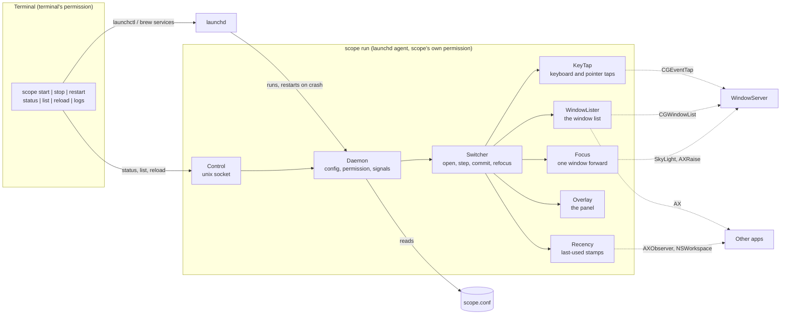

# Implementation

A specification for building scope from nothing. It states what scope must do, the macOS behaviour that dictates how, and the design that results, down to the constants. Every rule that looks arbitrary exists because of a platform fact in [Platform facts](#platform-facts); the rule cites it as **[Fn]**.

[README.md](README.md) covers using scope. The code in `Sources/Scope` is one implementation of this document.

The decision logic is specified by tests rather than prose: the key tap's state machine, recency and ranking, the refocus decision, selection, the config grammar and the launchd file. Where a section says **Specified by** a test file, the test names state each rule and its reason, and `swift test` checks them. This document keeps what tests cannot reach: what macOS does, and how the pieces are wired to it.

## Required behaviour

**Switcher**

- <kbd>⌘</kbd> <kbd>Tab</kbd> opens a vertical list of the **windows** on the **current Space**, most recently used first, and selects the second row. <kbd>⌘</kbd> <kbd>⇧</kbd> <kbd>Tab</kbd> opens it with the last row selected.
- Further <kbd>Tab</kbd> / <kbd>⇧</kbd> <kbd>Tab</kbd> while <kbd>⌘</kbd> is held moves the selection, wrapping around.
- Releasing <kbd>⌘</kbd> focuses the selected window. <kbd>esc</kbd> closes the list without switching.
- So a quick press-and-release always toggles between the two most recent windows.
- With the pointer, while <kbd>⌘</kbd> is held: hovering a row selects it, clicking a row switches to it, clicking anywhere else closes without switching. Clicks never reach the windows underneath.
- Fewer than two windows on the Space: nothing opens.
- Focusing brings forward that one window, not every window of its app.
- A native tab group (Terminal, Finder…) is one row, showing the tab that is up.
- The modifier is configurable: `cmd` replaces the system switcher, `alt` and `ctrl` run beside it.
- Every key other than the ones the switcher uses passes through untouched, and ⌘Tab is never lost to the system switcher, however slow other apps are.

**Refocus after a Space switch**

- On arriving at a Space, if macOS left nothing there focused, or focused a window only because its app was active on the Space you left, focus the window you last used on this Space.
- A window you chose (Dock, notification, Mission Control, scope itself) is left alone.
- If scope has never seen a window on this Space used, leave focus alone.

**Service**

- One signed binary, `scope`, run by launchd as a per-user agent: starts at login, restarted after a crash, not after a clean stop.
- Controlled with `scope start | stop | restart | reload | status | logs | list | run | version`.
- Configured by `~/.config/scope/scope.conf`; never writes it.
- Needs only the Accessibility permission. Asks for it once, then starts by itself when it is granted.

## Platform facts

What macOS does, as found while building scope, most recently on macOS 26. Each fact carries how sure we are of it:

- **observed**: seen happen while building scope, or measured with a probe;
- **documented**: Apple's documentation or headers say so, and nothing here contradicted it;
- **believed**: carried over from an earlier implementation, or reported elsewhere, and handled defensively, but not reproduced against the current code.

Re-check the *believed* ones before relying on them, and all of them after a major macOS release. [`scripts/tcc-probe`](scripts/tcc-probe) re-checks F23–F26 in a couple of minutes.

### Keys and events

- **F1.** The Dock owns <kbd>⌘</kbd> <kbd>Tab</kbd>. It cannot be registered as a hotkey (the registration fails or never fires), it is not a symbolic hotkey, and System Settings has no switch to disable it. A session event tap (`.cgSessionEventTap`, `.headInsertEventTap`, `.defaultTap`) sees the key before the Dock and can swallow it. *(observed)*
- **F2.** An event tap callback has a deadline. Miss it and the key goes on to the Dock: the system switcher appears, then scope's. *(observed)* macOS then disables the tap (`tapDisabledByTimeout`), and secure input (password fields) disables taps too (`tapDisabledByUserInput`); a disabled tap must be re-enabled by hand. *(documented)*
- **F3.** The modifier's release arrives as `flagsChanged`, not `keyUp`. *(observed)*
- **F4.** A tap that sees `mouseMoved` runs its callback on every pointer movement. *(observed)* Swallowing `mouseMoved` freezes the cursor. *(believed)*
- **F5.** Event locations are in global coordinates with a top-left origin. AppKit window frames have a bottom-left origin: `cgY = primaryScreenHeight − appKitMaxY`. *(documented)*

### Windows

- **F6.** `CGWindowListCopyWindowInfo([.optionOnScreenOnly, .excludeDesktopElements])` lists exactly the windows ordered in on the Spaces currently showing, frontmost first, with id, pid, layer and bounds, without any permission. *(observed)* Window *titles* from it need Screen Recording permission, so titles must come from Accessibility. *(documented)*
- **F7.** Document windows are layer 0. The menu bar, Dock, menus and floating panels are higher layers. *(observed)*
- **F8.** Many apps keep invisible helper windows in every Space to render popups (Microsoft Teams keeps a 680×932 window titled "Window"). They, and sheets and dialogs, have an Accessibility subrole other than `AXStandardWindow`. *(observed)*
- **F9.** Native window tabs: every tab is a separate window with its own id, but only the front tab is on screen and visible to Accessibility, and the tabs behind cannot be listed or targeted. *(observed)* Switching or closing tabs swaps windows without reliable notifications; a tab switched to by keyboard may announce nothing at all. *(believed: observed through an earlier window cache; not reproduced against an `AXObserver` on `kAXFocusedWindowChangedNotification`)*
- **F10.** An Accessibility window element maps to its window-server id only through the private `_AXUIElementGetWindow`. *(observed)*
- **F11.** Native-fullscreen windows each live on their own Space. *(observed)*
- **F12.** Maximized windows of one app on two Spaces can have identical frames. *(observed)*

### Accessibility

- **F13.** Some apps answer Accessibility slowly — Electron apps, and an Android emulator and IDE during a debug build — and the default timeout is seconds. *(observed)* `AXUIElementSetMessagingTimeout` on the system-wide element sets it for every call the process makes. *(documented)*
- **F14.** `AXObserverAddNotification` fails for an app that has only just launched, and succeeds a few seconds later. *(believed)*
- **F15.** Notifications are delivered asynchronously. A focus change from a switch made a moment ago may not have been seen yet when the next ⌘Tab arrives. *(observed)*
- **F16.** `AXIsProcessTrusted` changes post no notification; it must be polled. `AXIsProcessTrustedWithOptions` with the prompt option adds the process to the Accessibility list, so there is a switch to turn on. *(observed)*

### Focus and Spaces

- **F17.** Activating an app brings all its windows forward. *(observed)* One window alone needs the private `_SLPSSetFrontProcessWithOptions` with `kCPSUserGenerated` (0x200), then two synthesized "make key window" event records via `SLPSPostEventRecordTo`, then `AXRaise`; this sequence works. *(observed)* Without the event records, key focus can stay on another window of the same app, and `AXRaise` must come last because SetFrontProcess orders the app but not the window among the app's own. *(believed: the sequence AltTab uses, not tested with steps left out)*
- **F18.** A panel that accepts mouse events can take focus. `.nonactivatingPanel` with `ignoresMouseEvents` cannot. *(believed)*
- **F19.** Switching Spaces does not reliably move keyboard focus. The app active on the Space you left stays active if it has no window on the new one (Finder after a click on the desktop is the usual case): your last window is in front, but typing goes nowhere. If that app *does* have a window on the new Space, macOS focuses it, which looks exactly like a choice. *(observed)*
- **F20.** `activeSpaceDidChangeNotification` is posted after the switch animation. The switch itself fires activation, deactivation and focus-change notifications, so it generates "use" of the windows it lands on. *(observed)*
- **F21.** Choosing a window from the Dock, a notification or Mission Control activates its app (`didActivateApplicationNotification`). macOS carrying the active app over to a window on the new Space does not. *(observed)*
- **F22.** The active Space comes from the private `SLSGetActiveSpace(SLSMainConnectionID())` (older name: `CGS…`). *(observed)* Private symbols can disappear between macOS releases. *(believed)*

### Permission, signing, launchd

- **F23.** The Accessibility permission belongs to the *responsible* process. Started by launchd, that is the binary itself. Started from a shell, it is the terminal app, whatever binary runs. *(observed)*
- **F24.** An unbundled binary's permission is keyed to its **path** and its code signature's designated requirement. Same path, same certificate: the permission survives rebuilds. Another path, or an ad-hoc signature (which changes with every build): it must be granted again. *(observed)*
- **F25.** If the binary has a reverse-DNS signing identifier, or an `Info.plist` (embedded with `-sectcreate __TEXT __info_plist`, or simply next to the binary), tccd files the permission under a **bundle ID**, then fails to find an app with that ID (`kLSApplicationNotFoundErr`) and denies. The entry shows in System Settings with a folder icon, named after the identifier's last component; turning it on does nothing, and `tccutil reset` cannot remove it. *(observed)*
- **F26.** An untrusted self-signed code-signing certificate works for `codesign` and gives a stable designated requirement (`identifier "scope" and certificate leaf = H"…"`). `security find-identity -v` hides untrusted certificates; without `-v` it lists them. *(observed)*
- **F27.** Overwriting a signed binary in place while it runs is widely reported to get the process killed, at launch or when it next loads code from the changed file, because the kernel caches the old signature. Replacing the file by rename gives the new binary a new inode and cannot hit this. *(believed: a small test binary overwritten in place on macOS 26 kept running, and the next launch worked)*
- **F28.** `launchctl bootstrap` straight after `bootout` of the same label can fail transiently with an I/O error. *(believed)*
- **F29.** launchd agents do not inherit the shell's environment, and `$TMPDIR` can differ between them. *(documented)* `confstr(_CS_DARWIN_USER_TEMP_DIR)` gives the same directory to both. *(observed)*
- **F30.** `log stream` shows `notice` and above by default; `info` and `debug` messages are hidden. *(documented)*

### Homebrew

- **F31.** Homebrew installs each version of a formula into its own Cellar directory (`Cellar/scope/<version>`), so the binary's real path changes with every upgrade. `var` is shared by all versions. *(observed)*
- **F32.** Homebrew 7 labels a formula's service `sh.brew.<name>`; services started by older versions keep `homebrew.mxcl.<name>`. `brew services stop` removes the agent's file. `brew upgrade` and `brew reinstall` do not restart a running service. *(observed)*
- **F33.** A formula that installs a prebuilt, signed binary with `bin.install` leaves it byte for byte as released, signature intact. *(observed)*

## Non-goals and known gaps

**Deliberately not listed**, because they are not on screen in the current Space **[F6]**: windows on other Spaces, minimized windows, windows of hidden apps (⌘H), and the tabs behind the front tab of a tab group **[F9]**. Use Mission Control, the Dock or the app's own tab shortcuts for those.

**Deliberately not done:**

- Window thumbnails: they need Screen Recording permission **[F6]**.
- Cycling the windows of one app: macOS's own <kbd>⌘</kbd> <kbd>`</kbd> already does that, scoped to the current Space.
- Rebinding <kbd>Tab</kbd> or <kbd>esc</kbd>, or theming the overlay: the keys are fixed and the look is in code.
- Remembering use across restarts: stamps live in memory, so after a restart every window ranks by stacking order until it is used, and refocus stays out of the way until then.

**Untested:**

- **Several displays.** By default each display has its own Spaces, and the window list includes the visible Space of *every* display **[F6]**, so ⌘Tab lists windows from all displays at once. The active Space **[F22]** is the focused display's only, so tab-group matching and refocus consider only that display's Space, and the overlay opens on the display of the first window in the list. None of this has been tried with a second display, or with "Displays have separate Spaces" turned off.
- **Stage Manager.** Windows it has set aside may or may not count as on screen.
- **Several users logged in at once** (fast user switching): each gets their own agent and socket, which should be enough, but has not been tried.
- **The `brew services` handoff**: there is no Homebrew formula yet.

## Architecture

| Component | File | Responsibility |
|---|---|---|
| CLI | `main.swift`, `Service.swift` | Commands; launchd and `brew services` control |
| Daemon | `Daemon.swift` | The service process: config, permission, signals, socket answers |
| Control | `Control.swift` | Unix socket, client and server |
| Config | `Config.swift` | `scope.conf` parser |
| Switcher | `Switcher.swift` | The switcher's state; refocus after a Space switch (`Refocus`) |
| KeyTap | `KeyTap.swift` | Event taps and the open/closed decision |
| WindowLister | `Windows.swift` | The current Space's windows |
| Recency | `Recency.swift`, `Stamps.swift` | Last-used stamps: observers in `Recency`, the table and ranking in `StampTable` |
| Overlay | `Overlay.swift` | Drawing the list |
| Focus | `Focus.swift` | Bringing one window forward |
| SkyLight | `Private.swift` | Every private symbol |
| Support | `Support.swift` | Logging, version, a thread with its own run loop |

### Threads

The rule: nothing that can wait on another app runs where it can delay a key **[F2, F13]**.

| Thread | Runs | Must never |
|---|---|---|
| `scope.tap` (own run loop) | Tap callbacks: decide swallow or pass, post an action to main | wait for anything, call Accessibility, take a lock held across slow work |
| main | Switcher, Overlay, building the list, refocus, config reloads | — |
| `scope.recency` (own run loop) | AX observers and NSWorkspace stamps | — |
| `scope.focus` (serial queue) | `Focus.window` | — |
| `scope.control` | Socket accept loop; runs commands on main synchronously | — |
| concurrent pool | One AX query per app while building the list | — |

## KeyTap

Two taps on the `scope.tap` thread, created at start **[F1]**:

- **keys**: `keyDown` and `flagsChanged`, always enabled.
- **pointer**: `mouseMoved`, `leftMouseDragged`, `leftMouseDown`, `leftMouseUp`. Created disabled; enabled only while the overlay is on screen **[F4]**.

The tap's decisions live in `KeyTap.State`, a value with no CGEvent, lock or thread: which events are swallowed and what they mean, opening, stepping, committing and cancelling by key or pointer, sessions, and row hit-testing **[F3, F4, F5]**. **Specified by** `Tests/scopeTests/KeyTapTests.swift`.

The class around it:

- converts each CGEvent to a `KeyTap.Input` (flags, key code, location), runs `State.handle` under one lock, turns the pointer tap off when the output says the switcher closed, posts the action to main, and swallows or passes;
- on `tapDisabledByTimeout` / `tapDisabledByUserInput`, re-enables the keys tap, and the pointer tap if the overlay is up **[F2]**;
- `shown` and `closed` from main go through `State` too, and switch the pointer tap on or off as it answers.

## WindowLister

Built fresh on every open; there is no window cache **[F9]**.

1. `CGWindowListCopyWindowInfo([.optionOnScreenOnly, .excludeDesktopElements])` **[F6]**. Keep layer 0 only **[F7]**, drop scope's own pid. Record id, pid, bounds, and z (position in this list, 0 frontmost).
2. Group the ids by pid. For each pid, **in parallel** (`concurrentPerform`): read `kAXWindowsAttribute` of `AXUIElementCreateApplication(pid)`, map each element to an id with `_AXUIElementGetWindow` **[F10]**, keep the ids from step 1, and read subrole and title in one `AXUIElementCopyMultipleAttributeValues`.
3. Keep only `AXStandardWindow` **[F8]**.
4. An app that does not answer within the messaging timeout (250ms, set once on the system-wide element **[F13]**) is represented by its last known answer. Keep those answers in a table keyed by window id; when it passes 512 entries, drop the ids not on screen.
5. Result: windows in stacking order with id, pid, AX element, title, frame (top-left global) and z.

Fullscreen apps drop out by themselves **[F11]**. A tab group yields one window, the tab that is up **[F9]**.

## Recency

A table `window id → Stamp { at, previous, pid, frame, space }`, `at` in `systemUptime` seconds, guarded by a lock, written on the `scope.recency` thread.

**Stamp sources.** Each stamps the app's *focused* window (`kAXFocusedWindowAttribute`), with its frame and the active Space **[F22]**:

- an `AXObserver` per regular app for `kAXFocusedWindowChangedNotification`, its run-loop source on the recency thread. Observe every running regular app at start and each app on launch. If adding the notification fails, retry every second, five times **[F14]**. Remove on terminate, along with that pid's stamps.
- `didActivateApplicationNotification`;
- `didDeactivateApplicationNotification`. A tab switched to by keyboard may announce nothing, but the app still names it as focused on the way out, and every Space switch deactivates something **[F9, F20]**.
- the frontmost app once at start.

**The table and the ranking** are `StampTable`, a value with no Accessibility, lock or clock: recording a use, the use from before a burst of stamps, looking before a cutoff, the size limit, removing an app, most-recently-used order with never-used windows last in stacking order, and tab groups ranked by their newest tab **[F9, F12]**. **Specified by** `Tests/scopeTests/StampTableTests.swift`. `Recency` holds it under a lock and ranks with the active Space **[F22]**.

## Switcher

All on main.

**`currentWindows()`** = `recency.rank(lister.currentSpace())` with the live focused window (frontmost app's `kAXFocusedWindowAttribute`) moved to the front **[F15]**. The selection rules (first row selected, wrapping) and moving the focused window first are **specified by** `Tests/scopeTests/SwitcherTests.swift`.

**show(delta, session):** if already visible, step instead. Build the list; if fewer than 2 windows, tell the tap `closed(session)` and stop. Rows: title (or `(untitled)`), the app's `localizedName`, the app's icon (cached per pid, dropped on terminate). Show the overlay on the screen containing the centre of the first window, then `tap.shown(geometry, session)`. Arm the watchdog.

**select(row):** update the highlight, rearm the watchdog. **commit:** hide, then `Focus.window(selected)`. **cancel:** hide. Hiding always calls `tap.closed(session)`.

**Watchdog:** 10s without interaction tears the overlay down, in case a modifier release is ever missed. Rearmed on every selection, so choosing slowly with the mouse is not cut off.

### Refocus after a Space switch

The decision is `Refocus`, a value with no clock or Accessibility: when to override focus, when a focused window counts as chosen, ignoring scope's own activation, ranking by use from before the switch, and never guessing on a Space with no recorded use **[F19, F20, F21]**. **Specified by** `Tests/scopeTests/RefocusTests.swift`.

Wiring, in `Switcher`: `didActivateApplicationNotification` feeds `Refocus.activated`. `activeSpaceDidChangeNotification` (if `refocus` is on) feeds `Refocus.spaceChanged` and (re)starts a `Refocus.settle` (0.3s) timer, so the switch settles first. When it fires, unless the overlay is up: rank this Space's windows before `Refocus.cutoff`, ask `decide` with the live focused window and the frontmost app, and on `.focus` record `refocusing` and call `Focus.window`.

## Focus

On the `scope.focus` queue, because the target app may be the slow one:

1. `GetProcessForPID(pid)` → process serial number. (Deprecated and hidden from Swift; still exported.)
2. `_SLPSSetFrontProcessWithOptions(&psn, windowID, 0x200)`.
3. Post the make-key event record twice via `SLPSPostEventRecordTo(&psn, bytes)` **[F17]**: 0xf8 zero bytes; `[0x04] = 0xf8`, `[0x3a] = 0x10`, window id little-endian at `0x3c…0x3f`, `0xff` at `0x20…0x2f`; first with `[0x08] = 0x01`, then `[0x08] = 0x02`.
4. If any of that is unavailable or fails: set `kAXMainAttribute` on the window and activate the app (on main).
5. Always `AXRaise` last.

## Overlay

A borderless `NSPanel` with `.nonactivatingPanel`, `ignoresMouseEvents = true` **[F18]**, level `.popUpMenu`, clear background, shadow, `hidesOnDeactivate = false`, collection behaviour `canJoinAllSpaces, fullScreenAuxiliary, transient, ignoresCycle`. Shown with `orderFrontRegardless`. Icons and titles only: thumbnails would need Screen Recording **[F6]**.

| Property | Value |
|---|---|
| Width | 620 |
| Height | 2 × padding + rows × 54 |
| Padding | 10 |
| Corner radius | 16 |
| Position | centred in the screen's `visibleFrame`, rounded to whole points |
| Background | white 0.09, alpha 0.94; 1pt border white, alpha 0.13 |
| Selected row | sRGB (0.29, 0.40, 0.90), alpha 0.90, radius 10, inset by the padding |
| Icon | 36 × 36 at x = padding + 12, vertically centred in the row |
| Text x | padding + 12 + 36 + 14 |
| Title | system font 14, white alpha 0.98, at row y + 9, height 20, truncated at the tail |
| App name | system font 11, white alpha 0.52, at row y + 29, height 16, truncated at the tail |

The view is flipped (top-left origin). `show` returns the frame converted to global top-left coordinates for the tap **[F5]**.

## Private symbols

All in one file, looked up with `dlsym` (the SkyLight framework handle, then `RTLD_DEFAULT`) so a missing symbol degrades instead of failing to launch **[F22]**. `_AXUIElementGetWindow` is the exception: declared with `@_silgen_name`, it is required.

| Symbol | For | Fallback |
|---|---|---|
| `_AXUIElementGetWindow` | AX element → window id | none |
| `_SLPSSetFrontProcessWithOptions`, `SLPSPostEventRecordTo`, `GetProcessForPID` | single-window focus | activate the app |
| `SLSMainConnectionID`/`CGSMainConnectionID`, `SLSGetActiveSpace`/`CGSGetActiveSpace` | the active Space | tab groups match by pid and frame only |

## Service

### `scope run` (Daemon)

1. If the control socket answers `ping`, another instance runs: exit 1.
2. `NSApplication.shared` with activation policy `.accessory`: no Dock icon, but panels work.
3. Load the config, open the control socket, install signal handlers: `SIGHUP` reloads, `SIGTERM` and `SIGINT` remove the socket and exit 0 (so launchd does not restart it). Use dispatch signal sources after setting the signal to `SIG_IGN`.
4. If `AXIsProcessTrusted()`: start. Otherwise call `AXIsProcessTrustedWithOptions` with the prompt once **[F16]**, and poll every 5s.
5. Starting creates the taps. If they are refused although trusted, the permission entry belongs to another build: log how to fix it and keep polling **[F24, F25]**.
6. `NSApp.run()`.

### Configuration

`$XDG_CONFIG_HOME/scope/scope.conf` if that is an absolute path, else `~/.config/scope/scope.conf`. Never written.

The grammar, settings, defaults and warnings are **specified by** `Tests/scopeTests/ConfigTests.swift`. Warnings are logged and shown by `status` and `reload`.

### Control socket

`confstr(_CS_DARWIN_USER_TEMP_DIR)` + `scope.sock`, mode 0600 **[F29]**. The server unlinks a stale file before binding. One request per connection: the client writes a command and a newline, reads text to EOF. Server read timeout 2s, client 5s. Commands run on main.

| Command | Answer |
|---|---|
| `ping` | `pong` |
| `status` | version, pid, uptime, binary path, permission, switcher state, private-symbol availability, config path, effective settings, warnings |
| `list` | `currentWindows()` with app, title, window id and time since last use |
| `reload` | re-read the config, apply it, answer with the effective settings and warnings |

Commands run from a shell must go through the socket: they have the terminal's permission, not scope's **[F23]**, and only the service has the stamps.

### launchd

Label `io.github.np25071984.scope`, file `~/Library/LaunchAgents/<label>.plist`, domain `gui/<uid>`.

The file's contents are **specified by** `Tests/scopeTests/ServiceTests.swift`: this binary's real path **[F24]** with `run`, start at login, restart after a crash but not a clean exit, interactive, GUI sessions only, and `XDG_CONFIG_HOME` carried over **[F29]**. Output outside the unified log goes to `~/Library/Logs/scope.log`.

Commands:

- **start**: write the file if its contents differ. Not loaded → `bootstrap`. Loaded and the file changed → `bootout`, then `bootstrap`. Loaded and not running → `kickstart`. Then wait up to 3s for the socket to answer; if the permission is missing, say so and open `x-apple.systempreferences:com.apple.preference.security?Privacy_Accessibility`.
- **stop**: `bootout`. The file stays, so it starts again at the next login.
- **restart**: as start if not loaded or changed, else `kickstart -k`; then the same wait.
- **bootstrap** is retried every 200ms for up to 3s **[F28]**; `bootout` waits until the label is gone.
- **status**: `launchctl print gui/<uid>/<label>` for state and pid (parsing **specified by** `ServiceTests.swift`), then the socket's `status`. Exit 0 running, 3 not running, 4 without permission.
- **logs**: exec `log stream --style compact --predicate 'subsystem == "io.github.np25071984.scope" AND process == "scope"'`, or `log show --last <t>`.
- **list**: the socket's `list`; `--direct` builds the list in-process instead (stacking order, terminal's permission).

`brew services` owns the service when its agent file exists (`sh.brew.scope`, or `homebrew.mxcl.scope` from older Homebrew **[F32]**), or when the binary itself is Homebrew's: in a Cellar, or the service's copy in `var/scope` (rules **specified by** `ServiceTests.swift`). The path check matters because `brew services stop` removes the agent file **[F32]**; without it, `scope start` would create scope's own agent pointing into the versioned Cellar. Start, stop and restart then run `brew services <cmd> scope`, status reads that label, and `uninstall` refuses with the Homebrew commands. Warn if both kinds of agent are loaded: two copies would both take ⌘Tab.

The formula, `Formula/scope.rb` in this repository (tapped with `brew tap np25071984/scope https://github.com/np25071984/Scope`), installs the signed release tarball rather than building from source, which would sign ad hoc **[F24, F33]**. Its post-install steps copy the binary to `var/scope/scope`, replacing the old copy rather than rewriting it **[F27]**, and its service runs that copy: a path that stays the same across versions **[F31]**, with the release signature, so `brew upgrade` keeps the permission. The service is not restarted by an upgrade **[F32]**; the formula's caveats say to run `brew services restart scope`.

### Logging

Unified log, subsystem `io.github.np25071984.scope`. Lifecycle and warnings always; switcher decisions (each stamp, each list with its build time, apps that timed out, commits, refocus decisions) only with `trace = true`. Log at `notice` or above so `log stream` shows it without flags **[F30]**.

### Build, sign, install

- `swift build -c release`, executable product `scope`, macOS 13+, links AppKit and ApplicationServices. Releases are universal (`--arch arm64 --arch x86_64`).
- Sign: `codesign --force --options runtime --identifier scope --sign <identity>`. The identifier must be plain and there must be no `Info.plist` **[F25]**. The identity is `$SCOPE_SIGN_IDENTITY`, else the first *Developer ID Application*, *Apple Development* or *Scope Dev* in `security find-identity -p codesigning` (not `-v` **[F26]**), else ad hoc with a warning that the permission will not survive a rebuild **[F24]**.
- Two certificates, so two identities for the permission **[F24]**: local builds use the developer's own (*Scope Dev*); releases use the self-signed **scope release** certificate, whose designated requirement is `identifier scope and certificate root = H"a846bd7500d703aba7f80b68faf6df39ee954ca3"`. Its key exists only in the `release` environment's secrets. Swapping between a local build and a release needs the permission granted again. Losing the release key means a new certificate, and every user granting the permission again.
- Releases: a pushed `v*` tag runs `.github/workflows/release.yml`, which checks the tag against `version`, runs the tests, imports the certificate into a temporary keychain added to the search list (`codesign` finds an identity only there), builds with `build.sh --universal`, checks the designated requirement, and publishes `scope-macos.tar.gz` with its SHA-256 and the version's Changelog entry. No notarization: there is no Developer ID, so a browser-downloaded archive is quarantined; `curl` downloads are not.
- Install (`install.sh`): download the archive and checksum from the latest release (or `$SCOPE_VERSION`), verify the checksum, `codesign --verify --strict`, and the exact designated requirement above; then copy to `<prefix>/bin/scope.new`, `mv -f` over `<prefix>/bin/scope` (never overwrite in place **[F27]**), and run `scope restart`. Default prefix `~/.local`. `build.sh --install` does the same from a local build.
- Uninstall: `scope uninstall` boots the agent out and removes the plist, the log and its own binary; `scope.conf` stays. Refused when Homebrew owns the service.

## Constants

The stamp table's limits, the burst history, the tab-group frame tolerance and refocus timing are named constants on `StampTable` and `Refocus`, and covered by their tests. The rest:

| Constant | Value | Why |
|---|---|---|
| AX messaging timeout | 250ms | a slow app costs its own rows' freshness, not the switcher **[F13]** |
| Known-answer table | trimmed past 512 | windows not on screen are asked about again when they return |
| Observer retry | 1s × 5 | newly launched apps **[F14]** |
| Watchdog | 10s | a missed modifier release |
| Permission poll | 5s | no notification exists **[F16]** |
| Bootstrap retry | 200ms × 15 | **[F28]** |
| Socket timeouts | server 2s, client 5s | |

## Verification

A rebuild is done when `swift test` passes and every scenario below does. These need a real desktop: the tests cover the decisions, not macOS acting on them.

**Keys**

- [ ] ⌘Tab opens scope's list, never the system switcher, including while an Android emulator build or a busy Electron app is running.
- [ ] A quick ⌘Tab press-and-release, repeated, toggles between the same two windows.
- [ ] Two quick ⌘Tabs in a row: the second lands on the window you just left, not on a third.
- [ ] After typing in a password field, ⌘Tab still opens scope.
- [ ] With `modifier = alt`, ⌥Tab opens scope and ⌘Tab opens the system switcher.

**Pointer**

- [ ] Hover selects without switching; releasing ⌘ switches to the hovered row.
- [ ] Clicking a row switches; clicking elsewhere closes; neither click reaches the window underneath.
- [ ] The cursor never stalls while the list is open.

**Which windows**

- [ ] Only windows on the current Space; none from other Spaces or fullscreen apps.
- [ ] No Teams helper windows, sheets, dialogs, menus or panels.
- [ ] A Terminal window with tabs is one row titled after the tab that is up, also after switching tabs by keyboard and after closing the front tab.
- [ ] Committing to a tabbed window brings forward the tab that is up, not another.
- [ ] Choosing one window of an app with several brings forward that window only.

**Order**

- [ ] Use Terminal through tab A, switch to tab B by keyboard, use another app: Terminal still ranks above windows untouched for longer.

**Refocus**

- [ ] Click the desktop (Finder active), switch to a Space with a Terminal: typing goes to Terminal.
- [ ] The app you left has a window on the destination Space: the window you last used there gets focus, not that app's.
- [ ] Switching Spaces by clicking a window in the Dock or a notification keeps that window.
- [ ] `refocus = false` turns all of it off.

**Service**

- [ ] `./build.sh --install`, grant the permission: scope starts within 5s without a restart.
- [ ] Rebuild and reinstall: still allowed, no prompt.
- [ ] `kill -9` the service: launchd restarts it. `scope stop`: it stays stopped until `scope start` or the next login.
- [ ] `scope reload` and `kill -HUP` apply config changes.
- [ ] `scope status` exits 0 / 3 / 4 as documented; `scope list` works from a terminal without Accessibility permission.
- [ ] A second `scope run` exits instead of taking ⌘Tab twice.
