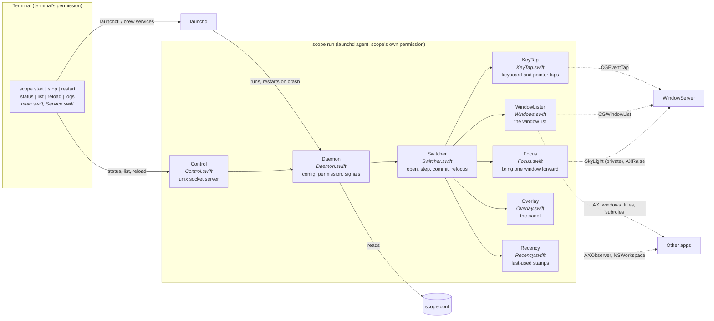
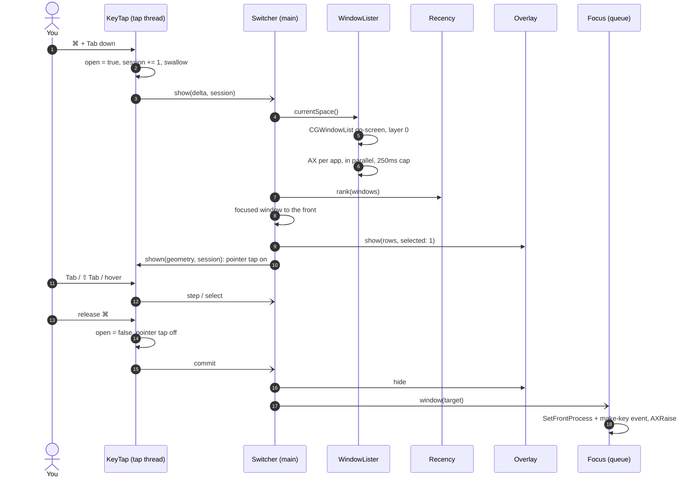

# Implementation

How scope works, and why it works that way. [README.md](README.md) covers using it; this is for changing it.

## Architecture

| File | Main type | Role |
|---|---|---|
| `main.swift` | — | Command-line entry point; `scope run` hands over to `Daemon` |
| `Service.swift` | `Service` | launchd: writes the agent's plist, bootstrap/bootout/kickstart, hands over to `brew services` |
| `Control.swift` | `Control` | The unix socket, client and server |
| `Daemon.swift` | `Daemon` | The service process: config, Accessibility permission, signals, socket answers |
| `Config.swift` | `Config` | Parses `scope.conf` |
| `Switcher.swift` | `Switcher` | What ⌘Tab opens, steps through and commits; refocus after a Space switch |
| `KeyTap.swift` | `KeyTap` | The keyboard and pointer event taps |
| `Windows.swift` | `WindowLister`, `Window`, `AX` | The window list: the current Space's windows, window server joined to Accessibility |
| `Recency.swift` | `Recency` | Most-recently-used stamps |
| `Overlay.swift` | `Overlay` | The panel that draws the list |
| `Focus.swift` | `Focus` | Bringing one window forward |
| `Private.swift` | `SkyLight` | Every undocumented call, looked up at run time |
| `Support.swift` | `Log`, `RunLoopThread` | Logging, version, a thread with its own run loop |

### Threads

Nothing that waits on another app runs where it can delay a key.

| Thread | Runs | Must never |
|---|---|---|
| `scope.tap` | Event tap callbacks: decide swallow or pass, post an action | wait for anything |
| main | `Switcher`, `Overlay`, the window list, refocus, config reloads | — |
| `scope.recency` | AX observers and NSWorkspace stamps | hold up the tap or the overlay |
| `scope.focus` (queue) | `Focus.window`: the target app may be the slow one | — |
| `scope.control` | Socket accept loop; hops to main for anything touching the switcher | — |
| concurrent | One AX query per app while building the list | take longer than 250ms per app |

## ⌘Tab, start to finish

The tap owns "is the switcher open". It flips the moment it swallows the activation, before the list exists, so a Tab or a ⌘ release that arrives while the list is still being built steps or commits instead of opening a second switcher. The main thread executes actions in the order they were posted.

## The window list

`WindowLister.currentSpace()` is built fresh on every open; there is no window cache to go stale.

1. **Which windows** come from `CGWindowListCopyWindowInfo([.optionOnScreenOnly, .excludeDesktopElements])`: exactly the windows ordered in on the Spaces showing, frontmost first, public API. Only layer 0 (document windows; menus, the Dock, floating panels and the menu bar sit higher), and never scope's own pid.
2. **Which are real windows, and their titles**, come from Accessibility: `kAXWindowsAttribute` per app, mapped to window-server ids with `_AXUIElementGetWindow`, subrole and title read in one `AXUIElementCopyMultipleAttributeValues`. Only `AXStandardWindow` counts.
3. Apps are asked in parallel (`DispatchQueue.concurrentPerform`), and a global AX messaging timeout of 250ms bounds each. An app that does not answer is represented by its last known answer (`known`, capped at 512 entries).
4. `Recency.rank` orders the result; windows never seen used go last, in stacking order.
5. The focused window, a live AX query, is moved to the front.

## Recency

Every window that gains focus is stamped with the time, its pid, frame and Space. Sources, all on the recency thread:

- an `AXObserver` per app for `kAXFocusedWindowChangedNotification`, which fires for any window, including a native tab the app swaps in;
- `didActivateApplication` and `didDeactivateApplication`, which stamp the app's focused window.

Each stamp also keeps `previous`: the newest use at least `Recency.history` (1s) older than itself. One switch fires a burst of stamps — activated, focus changed, deactivated — so "the use before this one" must reach past the burst. `rank(_:before:)` and `lastUsed(_:before:)` answer as of a cutoff, which is how refocus looks past the stamps its own Space switch caused.

A tab group ranks by the newest stamp of any window that is not on screen, has the same pid, a frame within 2pt and the same Space.

The table is capped at 1,024 stamps, oldest dropped first; a window untouched that long ranks by stacking order just as well. An app's stamps go when it quits.

## Refocus after a Space switch

`Switcher.spaceChanged` arms a 0.3s timer on `activeSpaceDidChangeNotification`, so the switch settles first. Then `refocus`:

1. `cutoff = spaceChangedAt − 1s` (`switchMargin`): the animation runs before the notification is posted, and it fires stamps of its own.
2. Rank this Space's windows by use before `cutoff`.
3. If a window here already has focus, leave it, unless both:
   - no app was activated after `cutoff` (`lastActivation`), and
   - it belongs to the frontmost app

   — which means macOS carried the active app over rather than you choosing a window. Choosing from the Dock, a notification or Mission Control activates an app; scope's own refocus activation, within 0.5s, does not count.
4. Focus the first window, but only if scope has seen it used. The order among never-used windows is stacking order, not a record of use, and macOS's own choice is better than a guess.

## Focusing

`SkyLight.focus` brings one window forward without the app's other windows:

1. `GetProcessForPID` (deprecated, hidden from Swift, still exported) for the process serial number.
2. `_SLPSSetFrontProcessWithOptions(psn, wid, kCPSUserGenerated)`, so the app is allowed to take focus.
3. Two synthesized "make key window" event records via `SLPSPostEventRecordTo`, the same bytes AltTab posts; without them key focus can stay on whichever of the app's windows had it.
4. `AXRaise` last, since SetFrontProcess orders the app forward but leaves the window where it was among the app's own.

If the private calls are missing, it sets `AXMain` and activates the app instead.

## Private calls

All in `Private.swift`, looked up with `dlsym` at run time so a symbol that disappears degrades to a fallback instead of a launch failure. `scope status` reports what is available.

| Call | For | Without it |
|---|---|---|
| `_AXUIElementGetWindow` | AX element → window-server id | (linked; required) |
| `_SLPSSetFrontProcessWithOptions`, `SLPSPostEventRecordTo`, `GetProcessForPID` | single-window focus | whole app activated |
| `SLSMainConnectionID` + `SLSGetActiveSpace` (or `CGS…`) | the active Space | tab groups rank by their own tab only |

## The service

### launchd

`scope start` writes `~/Library/LaunchAgents/io.github.np25071984.scope.plist` and bootstraps it into `gui/$UID`:

| Key | Why |
|---|---|
| `ProgramArguments = [<binary>, run]` | the resolved binary path, so a symlink in `PATH` cannot point launchd somewhere else |
| `RunAtLoad` | start at login |
| `KeepAlive = {SuccessfulExit: false}` | restart after a crash, not after `SIGTERM` (scope exits 0) |
| `ProcessType = Interactive`, `LimitLoadToSessionType = Aqua` | it handles keys, and only makes sense in a GUI session |
| `StandardOutPath`, `StandardErrorPath` | `~/Library/Logs/scope.log`, for anything outside the unified log |
| `EnvironmentVariables.XDG_CONFIG_HOME` | only if set when `start` ran; launchd does not pass the shell's environment |

The file is rewritten, and the agent reloaded, whenever its contents would change — a moved binary, a new `XDG_CONFIG_HOME`.

If `homebrew.mxcl.scope.plist` exists, start, stop and restart run `brew services` instead, and `start` warns when both agents are loaded.

### Control socket

`<per-user temp dir>/scope.sock`, mode 0600. The directory comes from `confstr(_CS_DARWIN_USER_TEMP_DIR)`, which is the same for launchd and a shell, unlike `$TMPDIR`. One request per connection: a command line, a text answer, close. Commands: `ping`, `status`, `list`, `reload`. `scope run` refuses to start when something already answers `ping`, and removes a stale socket file otherwise.

### Accessibility permission

macOS attributes the permission to the *responsible* process. Started by launchd, that is the scope binary, identified by **path and code signature**. Started from a shell, it is the terminal app. Hence the socket: commands run from a shell cannot see windows with scope's permission.

Found by experiment (macOS 26):

- A bare binary signed with the same certificate and installed to the same path keeps the permission across rebuilds. A different path needs it granted again.
- The signing identifier must be plain (`scope`) and the binary must carry no `Info.plist`, embedded or next to it. Otherwise tccd files the permission under a **bundle ID**, then fails to find an app for it (`kLSApplicationNotFoundErr`) and denies. The entry appears in System Settings with a folder icon, named after the identifier's last component, and turning it on does nothing. `tccutil reset` cannot remove it either, for the same reason.
- An untrusted self-signed certificate is enough; codesign uses it, and the designated requirement (`identifier "scope" and certificate leaf = H"…"`) is stable. `security find-identity -v` hides such certificates, so `build.sh` searches without `-v`.

Without the permission, the service asks once (`AXIsProcessTrustedWithOptions` with prompt, which adds the entry to the list) and polls every 5 seconds. Trusted but with the tap still refused means the entry belongs to another build; it keeps polling and logs how to fix it.

### Install

`build.sh --install` replaces the binary by rename, never rewriting it in place: the running service has the file open, and overwriting a signed binary that is in use gets the process killed. It then runs `scope restart`.

## Edge cases

Everything below broke at some point, or was found to need handling. "Since" is the release that first dealt with it.

### Keys

| Case | Handling | Since | Where |
|---|---|---|---|
| ⌘Tab cannot be registered as a hotkey: the Dock owns it, and System Settings has no switch for it | Session event tap at head-insert position, which sees keys before the Dock | 0.0.2 | `KeyTap.start` |
| A slow app holds the key handler past macOS's deadline, and ⌘Tab goes to the Dock, so the system switcher appears, then scope's | Tap callback only decides and posts; the list is built on main with the key already swallowed | 2.0.0 | `KeyTap.handle` |
| macOS disables a tap after a timeout, or when secure input starts | Re-enabled on `tapDisabledByTimeout` / `tapDisabledByUserInput` | 2.0.0 | `KeyTap.handle` |
| Tab or ⌘ release arrives while the list is still being built | The tap's own `open` flag decides, not the overlay's visibility | 2.0.0 | `KeyTap` |
| The next ⌘Tab arrives while the previous commit is still being carried out | Session numbers: a late `shown`/`closed` for an earlier session is ignored | 2.0.0 | `KeyTap.shown`, `closed` |
| A modifier release is missed and the overlay would hold Tab and Escape forever | 10s watchdog, rearmed on every selection so a slow mouse choice is not cut off | 1.0.0 | `Switcher.armWatchdog` |
| Only some keys should be taken | Swallows the activation, Tab and Escape while open; everything else passes; the ⌘ release itself passes | 0.0.1 | `KeyTap.handle` |

### Pointer

| Case | Handling | Since | Where |
|---|---|---|---|
| `mouseMoved` fires continuously | Pointer tap enabled only while the overlay is up | 1.0.0 | `KeyTap.shown`, `closed` |
| A panel that takes clicks could take focus from the window the click is about to hand it to | Overlay ignores the mouse; rows are hit-tested arithmetically in the tap | 1.0.0 | `KeyTap.Geometry.row` |
| A click on the overlay would reach the window underneath | Both mouse down and up are swallowed while open | 1.0.0 | `KeyTap.handle` |
| Swallowing mouse moves would freeze the cursor | Moves and drags always pass | 1.0.0 | `KeyTap.handle` |

### Which windows

| Case | Handling | Since | Where |
|---|---|---|---|
| Native tabs: every tab is a window, only the front one is visible to Accessibility, and a tab switch fires no event. Rows had stale titles, and committing pulled the stale tab forward | The list comes from the window server's on-screen windows on every open, so the tab that is up is always the one listed | 0.0.3, structurally 2.0.0 | `WindowLister.onScreen` |
| Closing the front tab: the tab that comes forward is never announced, and the app vanished from the list | Same: no cache, so the new front tab is simply on screen | 1.1.1, structurally 2.0.0 | `WindowLister` |
| Helper windows apps park in every Space (Teams: a 680×932 window titled "Window"), sheets, dialogs | `AXStandardWindow` only | 0.0.1 | `WindowLister.describe` |
| Menus, the Dock, floating panels, the menu bar | Window layer 0 only | 2.0.0 | `WindowLister.onScreen` |
| scope's own overlay | Own pid excluded | 2.0.0 | `WindowLister.onScreen` |
| Native-fullscreen apps | Each is its own Space, so it drops out naturally | 0.0.1 | — |
| Apps slow to answer Accessibility (Electron, an Android emulator and IDE in a debug build) | Parallel queries, 250ms messaging timeout, last known answer reused | 2.0.0 | `WindowLister.currentSpace` |
| A tab group has one front window and no way to target the others | Always one row; cycle tabs with the app's own shortcuts | 0.0.3 | — |

### Order

| Case | Handling | Since | Where |
|---|---|---|---|
| A quick press-and-release must toggle back, but the stamp for the switch just made may not have landed yet, so the window you are on ranked second and the overlay skipped past the one you wanted | The focused window, a live query, goes first whatever the stamps say | 1.1.0 | `Switcher.currentWindows` |
| An app used through a tab scope never saw focused sank to the bottom | App activation stamps the app's focused window | 1.1.2 | `Recency.start` |
| Using an app through one tab, then another, lost the first, so the app ranked as untouched for hours | A tab group ranks by the newest use of any of its tabs: same pid, frame within 2pt, same Space, not on screen | 1.2.1 | `Recency.rank` |
| A tab switched to by keyboard fires nothing scope hears | App *deactivation* stamps too: the app still names that tab as focused on the way out, and every Space switch deactivates something | 1.2.2 | `Recency.start` |
| Maximized windows of one app on two Spaces share a frame | The Space is part of the tab-group match | 1.2.1 | `Recency.rank` |
| An app that has only just launched cannot take an AX observer yet | Retried every second, five times | 2.0.0 | `Recency.observe` |

### Refocus after a Space switch

| Case | Handling | Since | Where |
|---|---|---|---|
| The app active on the Space you left stays active when it has nothing on the new one (Finder after a desktop click), so your last window is in front but typing goes nowhere | 0.3s after the switch settles, focus the window last used here if nothing here has focus | 1.2.0 | `Switcher.refocus` |
| A switch caused by choosing a window (Dock, notification) must be left alone | Only acts when nothing here is focused, or when focus was carried over (below) | 1.2.0 | `Switcher.refocus` |
| Nothing used on this Space since scope started (after a restart) | Leave focus alone rather than guess from stacking order | 1.2.2 | `Switcher.refocus` |
| The app you left also has a window here, and macOS focuses it on arrival | No activation around the switch plus a frontmost-app window means carried over, not chosen: overridden | 2.0.1 | `Switcher.refocus` |
| Arriving stamps the carried-over window, so it ranks first | Rank by use before the switch, with a 1s margin for the animation | 2.0.1 | `Recency.rank(_:before:)` |
| One switch fires a burst of stamps for the same window, so the "previous" use was a few ms old | Each stamp keeps the newest use at least 1s older than itself | 2.0.1 | `Recency.stampFocused` |
| scope's own refocus activates an app, and a quick switch back would read that as a choice | Activations of the refocused app within 0.5s are ignored | 2.0.1 | `Switcher.activated` |

### Service and permission

| Case | Handling | Since | Where |
|---|---|---|---|
| A menu bar app gave no sign it had started | A launchd service with `scope status` | 2.1.0 | `Service`, `Daemon` |
| A shell command gets the terminal's permission, not scope's | `status`, `list`, `reload` go through the socket | 2.1.0 | `Control` |
| `$TMPDIR` differs between launchd and a shell | Socket in `confstr(_CS_DARWIN_USER_TEMP_DIR)` | 2.1.0 | `Control.path` |
| A bundle identifier makes tccd look for an app that does not exist, and deny | Signed as plain `scope`, no `Info.plist` | 2.1.0 | `build.sh` |
| `find-identity -v` hides untrusted self-signed certificates, so builds fell back to ad hoc and lost the permission on every rebuild | Search without `-v` | 2.1.0 | `build.sh` |
| A bootstrap straight after a bootout fails with an I/O error | Retried for up to 3s | 2.1.0 | `Service.bootstrap` |
| Overwriting a signed binary that is running gets it killed | Install by rename | 2.1.0 | `build.sh` |
| launchd does not pass on the shell's environment | `XDG_CONFIG_HOME` written into the plist | 2.1.0 | `Service.writePlist` |
| Trusted, but the tap is refused | The permission entry belongs to another build: keep polling, log the fix | 2.0.0 | `Daemon.start` |
| Two copies would both take ⌘Tab | `scope run` exits if the socket answers; `start` warns about a loaded Homebrew agent; `build.sh` warns about a running Scope.app | 2.1.0 | `Daemon.run`, `Service`, `build.sh` |
