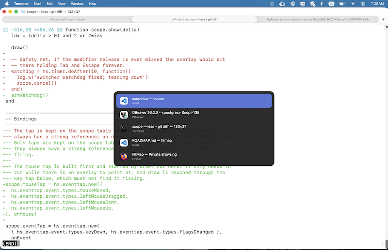

# Scope

Keyboard-first window switching on macOS, scoped to the current Space, and keyboard focus that follows you when you change Spaces.

## The problem

macOS <kbd>⌘</kbd> <kbd>Tab</kbd> switches *applications* across *all* Spaces. If you organise your work into Spaces, that defeats the purpose — you reach for the other window in front of you and get yanked into a different Space instead.

The closest native tool is Mission Control (three-finger swipe up, or <kbd>⌃</kbd> <kbd>↑</kbd>). It does show the current Space's windows, but you pick one by pointing at it. If you would rather not reach for gestures or the pointer to change windows, there is no native way to cycle the windows in this Space from the keyboard.

Switching Spaces has a second problem: the keyboard does not always come with you. Arrive on a Space and the window you were working in is in front, yet what you type goes nowhere, or into a window you did not pick, because macOS kept the previous Space's app active. You have to click the window first.

## What this does

scope does two things: a window switcher for the current Space, and focus that follows you when you change Spaces.

### Window switcher

Replaces the switcher with one that lists **windows** (not apps) from the **current Space only**, driven from the keyboard, with the pointer there when you would rather aim at the window you want than count Tabs to it.



| Shortcut | Action |
|---|---|
| <kbd>⌘</kbd> <kbd>Tab</kbd> | next window in the current Space |
| <kbd>⌘</kbd> <kbd>⇧</kbd> <kbd>Tab</kbd> | previous window |
| <kbd>esc</kbd> | dismiss without switching |
| release <kbd>⌘</kbd> | switch to the selected window |
| hover a row | select it, without switching yet |
| click a row | switch to that window |
| click anywhere else | dismiss without switching |

> <kbd>⌘</kbd> is the **Command** key, <kbd>⇧</kbd> is **Shift**, <kbd>⌃</kbd> is **Control**, and <kbd>⌥</kbd> is **Option** — the one between Control and Command, printed `alt` on some keyboards.

Hold <kbd>⌘</kbd>, tab to the window you want, release to select. Press <kbd>esc</kbd> while still holding <kbd>⌘</kbd> to back out and stay where you are.

The pointer works the same way, with <kbd>⌘</kbd> still held: hovering a row selects it, so releasing <kbd>⌘</kbd> over a row switches to that one, and clicking it switches without waiting for the release. A click anywhere off the overlay dismisses it. Nothing about the overlay outlives the modifier — it is the same gesture either way, which is also how the system switcher behaves. Set `mouse = false` to turn the pointer off entirely.

This replaces the system application switcher outright, so <kbd>⌘</kbd> <kbd>Tab</kbd> no longer reaches windows in other Spaces. Set `modifier = alt` to leave the system switcher alone and run scope on <kbd>⌥</kbd> <kbd>Tab</kbd> alongside it.

To cycle windows of the current app only, use the native <kbd>⌘</kbd> <kbd>`</kbd> — macOS already scopes that to the frontmost app and to the current Space, so scope does not rebind it.

### Focus follows you across Spaces

When you arrive on a Space, scope makes sure the keyboard goes to the window you last used there. You can type straight away, with no click first.

It steps in in two cases, a moment after the switch settles:

- **Nothing on the new Space has focus.** macOS keeps the previous Space's app active when it has no window here — Finder after a click on the desktop is the usual case — so your window is in front but not focused.
- **macOS focused a window you did not pick.** When the app you just left also has a window on the new Space, macOS hands focus to that window instead of the one you were working in.

It leaves focus alone when you chose where to go: a window clicked in the Dock, a notification, Mission Control, or scope's own switcher. It also leaves it alone on a Space where it has not yet seen you use any window, such as right after it starts, rather than guess. Set `refocus = false` to turn it off.

### The service

scope is a single binary run as a launchd service. It has no app bundle, Dock icon or menu bar: you control it with `scope start | stop | status | …` and configure it in a text file.

## Is scope for you?

scope is a tiny open-source tool: one 417 KB binary that does two things, a window switcher for the current Space and focus that follows you across Spaces. There is no app and no UI beyond the switcher itself. It runs as a background service you control from the terminal, and you configure it in a text file. It is built from source, with no installer, no automatic updates and no paid support.

It may not be what you want:

- **You want a UI**, with window thumbnails or windows from every Space: use [AltTab](https://alt-tab.app/). It is free and open source, with optional paid features.
- **You would rather pay** for a commercial switcher that comes with vendor support: look at [Witch](https://manytricks.com/witch/) or [Contexts](https://contexts.co/).
- **You only switch now and then:** macOS already has Mission Control (three-finger swipe up, or <kbd>⌃</kbd> <kbd>↑</kbd>) and <kbd>⌘</kbd> <kbd>`</kbd> for the windows of the frontmost app.

## Install

Needs macOS 13 or later and the Xcode command line tools.

```bash
./build.sh --install                       # ~/.local/bin/scope
./build.sh --install --prefix /opt/scope   # /opt/scope/bin/scope
```

This builds and signs `scope`, installs it, writes `~/Library/LaunchAgents/io.github.np25071984.scope.plist` and starts the service. From then on it starts at every login, and launchd restarts it if it crashes.

On first start, scope asks for **Accessibility** permission, its only one, and opens the right pane of System Settings. Turn on **scope** there. If it is not listed, add the binary with **+** (⌘⇧G to type the path). The service checks every 5 seconds and starts by itself once allowed.

To update, pull and run `./build.sh --install` again; the service restarts on the new binary and keeps its permission. To remove it:

```bash
./build.sh --uninstall [--prefix P]   # stops it, removes the binary and the launchd file
```

`scope.conf` is left in place.

### Signing, and why the permission can reset

macOS ties the Accessibility permission to the binary's **path and signature**. Rebuilt and installed to the same path with the same certificate, scope keeps it. Installed somewhere else, or signed ad hoc, it needs granting again.

`build.sh` signs with `$SCOPE_SIGN_IDENTITY`, else the first *Developer ID Application*, *Apple Development* or *Scope Dev* certificate in your keychain, else ad hoc. For local builds, create a self-signed certificate once: Keychain Access → Certificate Assistant → Create a Certificate…, name **Scope Dev**, type **Code Signing**. It does not need to be marked as trusted.

If System Settings shows a **scope** entry with a folder icon that does nothing when turned on, see [IMPLEMENTATION.md](IMPLEMENTATION.md#accessibility-permission).

## Commands

| Command | |
|---|---|
| `scope start` | start the service, writing its launchd file if it is missing or points at another binary |
| `scope stop` | stop it; it starts again at the next login |
| `scope restart` | restart it |
| `scope reload` | re-read `scope.conf` (or send the service `SIGHUP`) |
| `scope status` | launchd state, pid, permission, private-call availability, effective settings and config warnings. Exits 0 when running, 3 when not, 4 without permission. |
| `scope logs` | follow the service's log; `scope logs --last 1h` shows the past hour |
| `scope list` | the windows ⌘Tab would show, most recent first, each with when it was last used |
| `scope list --direct` | read the windows in this process instead: stacking order, and it needs the terminal to have Accessibility permission |
| `scope run` | the service in the foreground; what launchd runs |
| `scope version` | |

`status`, `list` and `reload` talk to the running service through a socket in the per-user temporary directory. That is deliberate: run from a shell, a command gets the terminal's Accessibility permission, not scope's, and only the service knows which windows were used when.

`launchctl` sees the service like any other agent:

```bash
launchctl print gui/$UID/io.github.np25071984.scope
launchctl kickstart -k gui/$UID/io.github.np25071984.scope
```

If scope is installed by a Homebrew formula, its agent is `homebrew.mxcl.scope`, owned by `brew services`. `scope start`, `stop` and `restart` then hand over to `brew services`, so the two never disagree.

## Configuration

`~/.config/scope/scope.conf`, or `$XDG_CONFIG_HOME/scope/scope.conf`. Every line is optional, and scope never writes the file.

```ini
modifier = cmd     # cmd replaces the system switcher; alt (⌥Tab) runs alongside it; ctrl
mouse    = true    # hover selects a row, click switches, click elsewhere dismisses
refocus  = true    # after a Space switch, focus the window last used there when macOS
                   # leaves nothing focused, or only carried the previous app over
trace    = false   # log every switcher decision
```

`#` starts a comment. Booleans take `true/false`, `yes/no`, `on/off` or `1/0`. A bad value or unknown key keeps the default for that line and is reported by `scope reload`, `scope status` and the log. Apply changes with `scope reload`.

## Diagnostics

`scope logs` follows the service's log: start, permission, reloads and warnings. With `trace = true` it also shows each focus stamp, each list with its build time, apps that timed out, and every commit and refocus decision. Anything the service prints outside the log, such as a crash, goes to `~/Library/Logs/scope.log`.

When the list comes out in the wrong order, `scope list` shows it as the switcher would, with each window's last use, so a window that was never seen used stands out.

## How it works

Architecture, threads, the window list, recency, refocus, the service and every edge case found so far are in [IMPLEMENTATION.md](IMPLEMENTATION.md).

The decision logic is covered by tests: `swift test`.

## Changelog

### 2.1.0 — 2026-10-31

scope is now a single `scope` binary run as a launchd service instead of Scope.app. Install with `./build.sh --install`, which puts it in `~/.local/bin` by default (`--prefix` to change), starts it, and has launchd start it at login and restart it after a crash. The menu bar is gone: settings move from user defaults to `~/.config/scope/scope.conf`, and `scope start | stop | restart | reload | status | logs | list` replace the menu. `scope list` now asks the running service, so it shows the switcher's own order with each window's last use, and no longer needs the terminal to have Accessibility permission. The *Enabled* switch is gone (`scope stop`), and so are *Launch at Login* and *Hide Menu Bar Icon*. The service checks for Accessibility permission every 5 seconds instead of showing an alert. `build.sh` now also finds a self-signed certificate that is not marked as trusted, which it used to skip, falling back to ad-hoc signing.

Upgrading from 2.0.x: quit Scope.app, delete `/Applications/Scope.app`, run `./build.sh --install`, and grant **scope** Accessibility permission. Settings are not carried over; set them again in `scope.conf`.

### 2.0.1 — 2026-10-31

Switching to a Space now focuses the window you last used there, even when the app you left also has a window on that Space. macOS focuses that app's window on arrival, and scope used to treat it as your choice and leave it. scope now recognises this case because no app was activated around the switch, and it ranks windows by their use from before the switch, since arriving stamps the carried-over window as used. A window you pick from the Dock, a notification or Mission Control is still left alone.

### 2.0.0

First native build, Scope.app. Versions 0.0.1 to 1.2.2 were a scripted predecessor; they remain in the git history.

## License

MIT — see [LICENSE](LICENSE).
