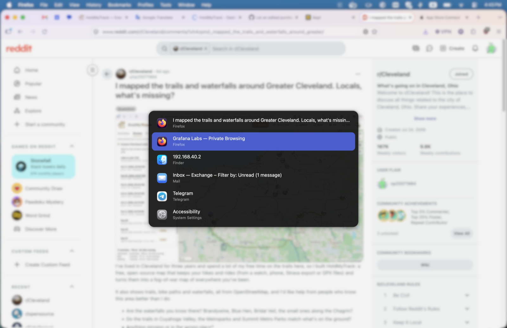

# Scope

Keyboard-first window switching on macOS, scoped to the current Space, with keyboard focus that follows you between Spaces. Its Space shortcuts switch instantly, or with a slide as long as you like.

## What macOS gets wrong

**<kbd>⌘</kbd> <kbd>Tab</kbd> leaves the Space.** macOS <kbd>⌘</kbd> <kbd>Tab</kbd> switches *applications* across *all* Spaces. If you organise your work into Spaces, that defeats the purpose — you reach for the other window in front of you and get yanked into a different Space instead. The closest native tool is Mission Control (three-finger swipe up, or <kbd>⌃</kbd> <kbd>↑</kbd>). It does show the current Space's windows, but you pick one by pointing at it. If you would rather not reach for gestures or the pointer to change windows, there is no native way to cycle the windows in this Space from the keyboard.

**The keyboard stays behind.** Arrive on a Space and the window you were working in is in front, yet what you type goes nowhere, or into a window you did not pick, because macOS kept the previous Space's app active. You have to click the window first.

**The Space shortcuts stall.** While a three-finger swipe is still sliding, a swipe back cancels it, but <kbd>⌃</kbd> <kbd>1</kbd> … <kbd>⌃</kbd> <kbd>9</kbd> do nothing: you wait for the slide to end and press again. The slide they start has a fixed length, too: no setting shortens it, and Reduce motion only swaps it for a fade.

## What this does

scope does three things:

- [A window switcher](#window-switcher) for the current Space.
- [Focus that follows you](#focus-follows-you-across-spaces) when you change Spaces.
- [Space shortcuts](#jump-to-a-space) that switch instantly, or with a slide as long as you choose, and still work while a swipe is sliding.

### Window switcher

Replaces the switcher with one that lists **windows** (not apps) from the **current Space only**, driven from the keyboard, with the pointer there when you would rather aim at the window you want than count Tabs to it.



| Shortcut | Action |
|---|---|
| <kbd>⌘</kbd> <kbd>Tab</kbd> | next window in the current Space |
| <kbd>⌘</kbd> <kbd>⇧</kbd> <kbd>Tab</kbd> | previous window |
| <kbd>esc</kbd> | dismiss without switching |
| release <kbd>⌘</kbd> | switch to the selected window |
| hover a row | select it, without switching yet |
| click a row | switch to that window |
| click anywhere else | dismiss without switching |

> <kbd>⌘</kbd> is the **Command** key, <kbd>⇧</kbd> is **Shift**, <kbd>⌃</kbd> is **Control**, and <kbd>⌥</kbd> is **Option** — the one between Control and Command, printed `alt` on some keyboards.

Hold <kbd>⌘</kbd>, tab to the window you want, release to select. Press <kbd>esc</kbd> while still holding <kbd>⌘</kbd> to back out and stay where you are.

The pointer works the same way, with <kbd>⌘</kbd> still held: hovering a row selects it, so releasing <kbd>⌘</kbd> over a row switches to that one, and clicking it switches without waiting for the release. A click anywhere off the overlay dismisses it. Nothing about the overlay outlives the modifier — it is the same gesture either way, which is also how the system switcher behaves. Set `mouse = false` to turn the pointer off entirely.

This replaces the system application switcher outright, so <kbd>⌘</kbd> <kbd>Tab</kbd> no longer reaches windows in other Spaces. Set `modifier = alt` to leave the system switcher alone and run scope on <kbd>⌥</kbd> <kbd>Tab</kbd> alongside it.

To cycle windows of the current app only, use the native <kbd>⌘</kbd> <kbd>`</kbd> — macOS already scopes that to the frontmost app and to the current Space, so scope does not rebind it.

### Focus follows you across Spaces

When you arrive on a Space, scope makes sure the keyboard goes to the window you last used there. You can type straight away, with no click first.

It corrects three cases:

- **Nothing on the new Space has focus.** macOS keeps the previous Space's app active when it has no window here — Finder after a click on the desktop is the usual case — so your window is in front but not focused.
- **macOS focused a window you did not pick.** When the app you just left also has a window on the new Space, macOS hands focus to that window instead of the one you were working in.
- **macOS picked another app for the Space.** When the app last in front on a Space has no window there — a link that opened in a browser on another Space is the usual case — macOS chooses an app for the Space on your way back, and not the one you were using. scope corrects it as soon as it sees the pick, so the wrong app shows for a moment at most.

It leaves focus alone when you chose where to go: a window clicked in the Dock, a notification, Mission Control, or scope's own switcher. It also leaves it alone on a Space where it has not yet seen you use any window, such as right after it starts, rather than guess. Set `refocus = false` to turn it off.

### Jump to a Space

The "Switch to Desktop N" shortcuts, <kbd>⌃</kbd> <kbd>1</kbd> … <kbd>⌃</kbd> <kbd>9</kbd> by default, take you to that Space, and with `refocus` on, to the window you last used there. Set `spaces = 0` and they switch instantly, with no slide; or set the slide's length in seconds, or keep macOS's own with `spaces = macos`, the default. Pressed while a swipe is still sliding, when macOS would ignore them, a shortcut goes straight to its Space, cancelling the swipe if that is where you started.

scope uses the shortcuts that are on in System Settings → Keyboard → Keyboard Shortcuts → Mission Control, with whatever keys they are set to; run `scope reload` after changing them. scope's own slides work the way [InstantSpaceSwitcher](https://github.com/jurplel/InstantSpaceSwitcher)'s do, with a synthetic trackpad swipe. A slide of a set length needs macOS 27 or later; on earlier versions any length switches at once, and `scope status` and `scope reload` say so.

Other ways of changing Space don't go through scope: three-finger swipes, Mission Control and Stage Manager work exactly as before. scope only steps in afterwards, to put keyboard focus on the window you last used there, as described in [Focus follows you across Spaces](#focus-follows-you-across-spaces).

## Is scope for you?

scope is a small open-source tool, about 1 MB, for people who change windows and Spaces from the keyboard. It is intentionally built as a background service: there is no app, Dock icon or menu bar, and no UI beyond the switcher; you set it up in a text file and control it from the terminal. It installs with one command in Terminal, with no app to drag anywhere and no automatic updates.

It may not be what you want:

- **You want a UI**, with window thumbnails or windows from every Space: use [AltTab](https://alt-tab.app/). It is free and open source, with optional paid features, and it can also limit its list to the current Space. What scope adds is refocus, so after a Space switch you can type straight into the window you last used there, and Space shortcuts that work mid-swipe. It never asks for Screen Recording, which AltTab needs for thumbnails.
- **You would rather pay** for a commercial switcher that comes with vendor support: look at [Witch](https://manytricks.com/witch/) or [Contexts](https://contexts.co/).
- **You only switch now and then:** macOS already has Mission Control (three-finger swipe up, or <kbd>⌃</kbd> <kbd>↑</kbd>) and <kbd>⌘</kbd> <kbd>`</kbd> for the windows of the frontmost app.

## Install

Needs macOS 13 or later, on Apple Silicon or Intel. In Terminal:

```bash
curl -fsSL https://raw.githubusercontent.com/np25071984/Scope/main/install.sh | sh
```

This downloads the latest release, checks its checksum and signature, installs `~/.local/bin/scope` and starts the service. From then on it starts at every login, and launchd restarts it if it crashes.

On first start, scope asks for **Accessibility** permission, its only one, and opens the right pane of System Settings. Turn on **scope** there. If it is not listed, add `~/.local/bin/scope` with **+** (⌘⇧G to type the path). The service checks every 5 seconds and starts by itself once allowed.

**Upgrade** by running the same command again. The service restarts on the new version and keeps its permission.

**Remove** it with `scope uninstall`. It stops the service and removes the binary, its launchd file and its log; `scope.conf` is left in place. Remove **scope** from the Accessibility list by hand.

To install a particular release, or somewhere other than `~/.local`, set `SCOPE_VERSION=v2.2.0` or `SCOPE_PREFIX=/opt/scope` for `sh`, after the `|`. Keep the prefix the same from then on: macOS ties the permission to the binary's path, so a new path needs it granted again.

Releases are signed with scope's own self-signed certificate, not an Apple Developer ID, so they are not notarized. The installer is unaffected. A release archive downloaded with a browser, though, is quarantined, and macOS refuses to run it until you clear that: `xattr -d com.apple.quarantine scope`.

### With Homebrew

```bash
brew tap np25071984/scope https://github.com/np25071984/Scope
brew trust np25071984/scope
brew install scope
brew services start scope
```

Homebrew loads formulae from a tap only once you trust it, hence `brew trust`. Then turn on **scope** in Accessibility; if it is not listed, add `$(brew --prefix)/var/scope/scope`, which is the copy the service runs. Upgrade with `brew upgrade scope && brew services restart scope`; the permission is kept. Remove with `brew services stop scope && brew uninstall scope && rm -rf $(brew --prefix)/var/scope`.

Use either Homebrew or the installer, not both: both would take ⌘Tab. To switch from the installer, run `scope uninstall` first.

### Building from source

For working on scope. Needs the Xcode command line tools.

```bash
./build.sh                                 # build and sign build/scope
./build.sh --install                       # also install ~/.local/bin/scope and restart the service
./build.sh --install --prefix /opt/scope   # /opt/scope/bin/scope
./build.sh --universal                     # Apple Silicon and Intel in one binary, as releases are
swift test                                 # the decision logic
```

macOS ties the Accessibility permission to the binary's **path and signature**. Rebuilt and installed to the same path with the same certificate, scope keeps it. Installed somewhere else, signed ad hoc, or swapped between a local build and a release (each signed with a different certificate), it needs granting again. An entry already in the list for that path does not carry over to a binary signed differently, even when it is switched on: remove it with **−** and add the binary again with **+**.

`build.sh` signs with `$SCOPE_SIGN_IDENTITY`, else the first *Developer ID Application*, *Apple Development* or *Scope Dev* certificate in your keychain, else ad hoc. For local builds, create a self-signed certificate once: Keychain Access → Certificate Assistant → Create a Certificate…, name **Scope Dev**, type **Code Signing**. It does not need to be marked as trusted.

If System Settings shows a **scope** entry with a folder icon that does nothing when turned on, see [IMPLEMENTATION.md](IMPLEMENTATION.md#accessibility-permission).

## Commands

| Command | |
|---|---|
| `scope start` | start the service, writing its launchd file if it is missing or points at another binary |
| `scope stop` | stop it; it starts again at the next login |
| `scope restart` | restart it |
| `scope reload` | re-read `scope.conf` (or send the service `SIGHUP`) |
| `scope status` | launchd state, pid, permission, private-call availability, effective settings and config warnings. Exits 0 when running, 3 when not, 4 without permission. |
| `scope logs` | follow the service's log; `scope logs --last 1h` shows the past hour |
| `scope list` | the windows ⌘Tab would show, most recent first, each with when it was last used |
| `scope list --direct` | read the windows in this process instead: stacking order, and it needs the terminal to have Accessibility permission |
| `scope run` | the service in the foreground; what launchd runs |
| `scope uninstall` | stop the service and remove scope; `scope.conf` is kept |
| `scope version` | |

`status`, `list` and `reload` talk to the running service through a socket in the per-user temporary directory. That is deliberate: run from a shell, a command gets the terminal's Accessibility permission, not scope's, and only the service knows which windows were used when.

`launchctl` sees the service like any other agent:

```bash
launchctl print gui/$UID/io.github.np25071984.scope
launchctl kickstart -k gui/$UID/io.github.np25071984.scope
```

Installed with Homebrew, the service belongs to `brew services` (label `sh.brew.scope`). `scope start`, `stop` and `restart` then hand over to `brew services`, so the two never disagree.

## Configuration

`~/.config/scope/scope.conf`, or `$XDG_CONFIG_HOME/scope/scope.conf`. Every line is optional, and scope never writes the file.

```ini
modifier = cmd     # cmd replaces the system switcher; alt (⌥Tab) runs alongside it; ctrl
mouse    = true    # hover selects a row, click switches, click elsewhere dismisses
refocus  = true    # after any Space switch, put focus on the window you last used there,
                   # unless you picked a window to go to (Dock, notification, Mission Control)
spaces   = macos   # how the Switch to Desktop N shortcuts (⌃1…⌃9) slide:
                   #   macos  macOS's own slide
                   #   0.4    a slide of that many seconds (about 0.05 to 0.9, timed on
                   #          macOS 27 with a 120Hz display); 0 for none
trace    = false   # log every switcher decision
```

`#` starts a comment. Booleans take `true/false`, `yes/no`, `on/off` or `1/0`. A bad value or unknown key keeps the default for that line and is reported by `scope reload`, `scope status` and the log. Apply changes with `scope reload`.

## Diagnostics

`scope logs` follows the service's log: start, permission, reloads and warnings. With `trace = true` it also shows each focus stamp, each list with its build time, apps that timed out, and every commit, refocus decision and Space jump. Anything the service prints outside the log, such as a crash, goes to `~/Library/Logs/scope.log`.

When the list comes out in the wrong order, `scope list` shows it as the switcher would, with each window's last use, so a window that was never seen used stands out.

## How it works

Architecture, threads, the window list, recency, refocus, the service and every edge case found so far are in [IMPLEMENTATION.md](IMPLEMENTATION.md).

The decision logic is covered by tests: `swift test`.

## Changelog

What changed in each release, back to the first: [CHANGELOG.md](CHANGELOG.md).

## License

MIT — see [LICENSE](LICENSE).
